# Rapport Technique - Projet 11 “SEN-TRANSPORT” :  Base de données, analyse et interprétation des données

[Projet 11 DashboardBI.pdf](/PPT%20PROJET%2011%20(2).jpg)

## Avant - Propos :

> Ce rapport, faisant état de **fiche technique**, présente et explique en détail notre travail **analytique pour l’exploitation des données des utilisateurs** des transports publics à Dakar, Sénégal, plus particulièrement du **TER et du BRT** au sein de **l’ISJA de Dakar**.
Au delà de rendre compte de notre **travail de recherche et d’analyse**, l’objectif final est de fournir une explication concise et compréhensible, même pour les non-initiés à **l’informatique technique**.
> 
> 
> ### **Les Objectifs :**
> 
> - **Profilage des utilisateurs** : catégorisation des usagers (élèves, personnel, etc.).
> - **Analyse des trajets** : étude des trajets réalisés et des fréquences d’utilisation.
> - **Mesure de la satisfaction** : évaluation des retours d’expérience des utilisateurs.
> - **Propositions d’innovations** : suggestions d’améliorations basées sur les données récoltées.
> 

---

## Sommaire du rapport :

## Sommaire du rapport

1. [Introduction aux Concepts Fondamentaux des Bases de Données Relationnelles](#introduction-aux-concepts-fondamentaux-des-bases-de-données-relationnelles)
2. [Modélisation des Données](#modélisation-des-données)
   - [Modèle Conceptuel de Données (MCD)](#modèle-conceptuel-de-données-mcd)
   - [Modèle Logique de Données (MLD)](#modèle-logique-de-données-mld)
3. [Mise en Œuvre Technique : Le Contenu de notre base de données](#mise-en-œuvre-technique--le-contenu-de-notre-base-de-données)
   - [Création des Tables dans MySQL](#création-des-tables-dans-mysql)
4. [Analyse et manipulation des données de la base](#analyse-et-manipulation-des-données-de-la-base)
5. [Interprétation et exploitation des résultats de l’analyse](#interprétation-et-exploitation-des-résultats-de-lanalyse)
6. [Conclusion](#conclusion)


---

## **Les membres du cabinet CES-IT** :

- **Seyni Jr. Baldé**, **Ingénieur de Données et chef de projet chez *CES-IT** (créateur du rapport technique)*
- **Jean Léandre Tiemtoré**,  **Ingénieur en Optimisation et Performance** chez *CES-IT (auteur du rapport courant et de la méthode GAR)*
- **Sonia Hameg**, **Ingénieur en Conception Technique et RSE** chez *CES-IT (auteur des schéma techniques et de l’insertion de la RSE)*

---

# 1. Introduction aux Concepts Fondamentaux des Bases de Données Relationnelles

Dans le cadre de notre projet de digitalisation et d'optimisation des données des usagers du TER et du BRT au sein de l’établissement, il est essentiel de bien comprendre les principes des bases de données relationnelles et les concepts fondamentaux associés. **Cette section présente les notions de base qui sont au cœur de la structuration, de la gestion et de l’analyse des données dans notre projet.**

## Concepts de Base des Bases de Données Relationnelles

### **Qu’est-ce qu’une “Base de Données“(BDD) ?**

> Une **base de données** est un ensemble structuré de données stockées et organisées pour permettre une gestion, une consultation et une manipulation efficaces.
> 

Elle regroupe des informations de manière cohérente, offrant un accès centralisé et contrôlé aux données, qui peuvent être récupérées et analysées pour une prise de décision éclairée. Dans notre projet, la base de données comprend des informations sur les `utilisateurs`, les `trajets`, les `moyens de transport`, les `stations` et les `enquêtes de satisfaction`.

1. **Table**
    
    > Une **table** est la structure de base d’une base de données relationnelle, organisée sous forme de lignes et de colonnes. Chaque ligne (ou enregistrement) correspond à une entité spécifique, tandis que chaque colonne représente un attribut de ces entités.
    > 
    
    Par exemple, dans une table "Utilisateur", les colonnes peuvent inclure `id_utilisateur`, `nom`, `prenom`, et `type_utilisateur`.
    
2. **Schéma de Base de Données**
    
    > Le **schéma de base de données** est la structure globale qui définit la façon dont les données sont organisées et reliées dans une base de données. Il spécifie les tables, leurs colonnes, et les relations entre elles.
    > 
    
    Un schéma bien défini garantit que les données sont structurées logiquement, facilitant ainsi l’accès, la manipulation et l'intégrité des informations. Notre projet repose sur un schéma intégrant plusieurs tables reliées entre elles pour gérer des informations complexes sur les trajets des usagers.
    
3. **Relation**
    
    > Une **relation** est un lien entre deux tables dans une base de données relationnelle. Les relations permettent de structurer les données en connectant des informations provenant de tables différentes grâce à des clés, facilitant ainsi l'analyse de données complexes.
    > 
    
    Dans notre projet, par exemple, une relation existe entre les tables "Utilisateur" et "Trajet", où chaque utilisateur peut être lié à plusieurs trajets, facilitant la modélisation des comportements d'utilisation.
    
4. **Clé Primaire et Clé Étrangère**
    
    > Une **clé primaire** est un identifiant unique pour chaque enregistrement dans une table, garantissant l’unicité des données.
    > 
    > 
    > Par exemple, `id_utilisateur` dans la table "Utilisateur" permet d’identifier chaque usager de manière unique.
    > 
    
    > Une **clé étrangère** est un champ qui fait référence à la clé primaire d’une autre table, créant une relation entre les deux tables.
    > 
    > 
    > Par exemple, `id_utilisateur` dans la table "Trajet" est une clé étrangère qui relie chaque trajet à un utilisateur spécifique.
    > 
5. **SQL (Structured Query Language)**
    
    > Le **SQL** est le langage standard utilisé pour **interagir avec les bases de données relationnelles**. Il permet de créer et modifier les structures de la base de données (Data Definition Language - DDL), d’insérer et manipuler les données (Data Manipulation Language - DML) et de contrôler les accès aux données (Data Control Language - DCL).
    > 
    
    Dans ce projet, SQL est employé pour créer les tables, insérer les données, et exécuter des requêtes analytiques afin de tirer des informations utiles pour l’amélioration des services de transport.
    
6. **Intégrité des Données**
    
    > L’**intégrité des données** garantit que les informations stockées dans la base de données restent exactes, cohérentes et fiables au fil du temps. Elle est assurée par des règles et contraintes, telles que les clés primaires et étrangères, et par des mécanismes transactionnels.
    > 
    
    Dans notre projet, cela permet de s’assurer que les données des trajets et des utilisateurs sont bien structurées et exemptes d’erreurs.
    

<aside>

> Ces concepts forment **la base introductive** de notre projet, permettant de structurer et gérer efficacement les données des usagers du TER et du BRT, facilitant ainsi les analyses et les améliorations de service pour une meilleure expérience utilisateur.
> 
</aside>

---

---

# **2. Modélisation des Données**

### **2.1. Modèle Conceptuel de Données (MCD)**

> **Le MCD permet de définir les entités et les relations entre elles.**
> 

Voici les principales **entités de notre étude projet** :

- `**Utilisateur** :` Représente les informations des usagers (élèves, personnel).
- `**Transport** :` Type de transport utilisé (TER, BRT, autre).
- `**Station** :` Stations desservies par les moyens de transport.
- `**Trajet** :` Informations sur les trajets réalisés par les utilisateurs.
- `**Enquête** :` Réponses aux enquêtes sur la satisfaction des usagers.

### Schéma MCD simplifié

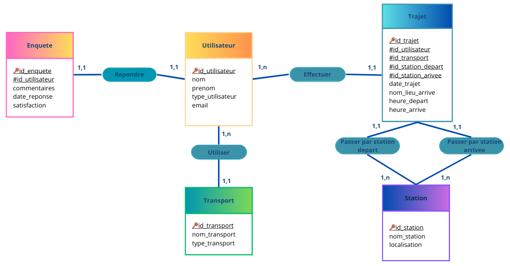

### **2.2. Modèle Logique de Données (MLD)**

> **Le MLD est la traduction technique du MCD, structuré sous forme de tables relationnelles dans la base de données MySQL.**
> 

### Schéma MLD Technique JMerise

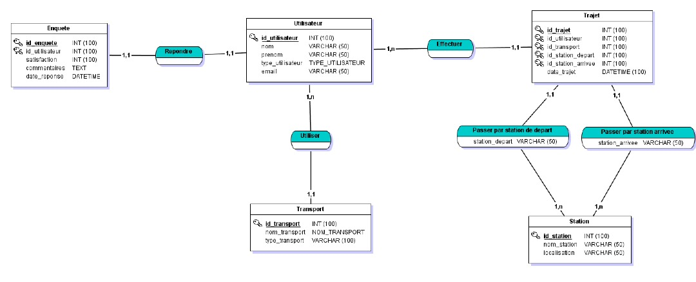

### **Utilisateur**

- `id_utilisateur :` INT (Clé Primaire)
- `nom :` VARCHAR(50)
- `prenom :` VARCHAR(50)
- `type_utilisateur :` VARCHAR(50)
- `email :` VARCHAR(50)

### **Transport**

- `id_transport :` INT (Clé Primaire)
- `nom_transport:` VARCHAR(50)
- `type_transport :` VARCHAR(100)

### **Station**

- `id_station :` INT (Clé Primaire)
- `nom_station :` VARCHAR(50)
- `localisation :` VARCHAR(50)

### **Trajet**

- `id_trajet** :` INT (Clé Primaire)
- `id_utilisateur:` INT (Clé Étrangère → UTILISATEUR)
- `id_transport :` INT (Clé Étrangère → TRANSPORT)
- `id_station_depart :` INT (Clé Étrangère → STATION)
- `id_station_arrivee :` INT (Clé Étrangère → STATION)
- `date_trajet :` DATETIME
- `nom_lieu_depart :` VARCHAR
- `nom_lieu_arrivee :` VARCHAR
- `heure_depart :` TIME
- `heure_arrivee :` TIME

## Relations

1. `UTILISATEUR - TRAJET`
    - Un **UTILISATEUR** peut effectuer plusieurs **TRAJETS**
    - Un **TRAJET** est effectué par un seul **UTILISATEUR**
2. `TRAJET - TRANSPORT`
    - Un **TRAJET** utilise un seul **TRANSPORT**
    - Un **TRANSPORT** peut être utilisé dans plusieurs **TRAJETS**
3. `TRAJET - STATION (Départ)`
    - Un **TRAJET** a une seule **STATION** de départ
    - Une **STATION** peut être le point de départ de plusieurs **TRAJETS**
4. `TRAJET - STATION (Arrivée)`
    - Un **TRAJET** a une seule **STATION** d'arrivée
    - Une **STATION** peut être le point d'arrivée de plusieurs **TRAJETS**
5. `UTILISATEUR - ENQUETE`
    - Un **UTILISATEUR** peut répondre à plusieurs **ENQUETES**
    - Une **ENQUETE** est répondue par un seul **UTILISATEUR**

### **Enquête**

- **`id_enquete :`** INT (Clé Primaire)
- `id_utilisateur :`  INT (Clé Étrangère → UTILISATEUR)
- `commentaires :` TEXT
- `date_reponse` : DATETIME
- `satisfaction :` INT

---

# **3. Mise en Œuvre Technique : Le Contenu de notre base de données**

> Dans cette partie, nous détaillons **le processus de création** des différentes **entités / tables** de notre base de données directement dans l’éditeur de code. En bref, nous passons de l’aspect abstrait des schémas MLD et MCD à un modèle réel et exploitable en implémenté en SQL (qui est le langage de requetes nous permettant d’intéragir avec ces tables et d’en extraire les informations de notre choix).
> 

### **Création des Tables dans MySQL :**

> Requetes de **création** et **affichage** des tables de la base de donnée grace au **langage SQL**
> 

## Table Utilisateur

```sql
-- Création de la table Utilisateur
CREATE TABLE IF NOT EXISTS Utilisateur (
    id_utilisateur INT AUTO_INCREMENT PRIMARY KEY,
    nom VARCHAR(50) NOT NULL,
    prenom VARCHAR(50) NOT NULL,
    type_utilisateur VARCHAR(100) NOT NULL,
    email VARCHAR(100) NOT NULL UNIQUE);
```

### **Affichage de la table en naturel :**

| id_utilisateur | nom | prenom | type_utilisateur | email |
| --- | --- | --- | --- | --- |
| 1 | Diallo | Pape | élève | pape.diallo714@example.com |
| 2 | Touré | Aissatou | élève | aissatou.touré987@example.com |
| 3 | Cissé | Moussa | prof | moussa.cissé95@example.com |
| 4 | Gueye | Aissatou | élève | aissatou.gueye833@example.com |
| 5 | Ndour | Nafi | élève | nafi.ndour786@example.com |
| 6 | Bâ | Amadou | personnel | amadou.bâ757@example.com |
| 7 | Diallo | Aminata | élève | aminata.diallo936@example.com |
| 8 | Diouf | Mame Cheikh | prof | diouf.diouf916@example.com |
| 9 | Faye | Astou | personnel | astou.faye908@example.com |
| 10 | Seck | Coumba | élève | coumba.seck853@example.com |
| 11 | Gueye | Serigne | personnel | serigne.gueye783@example.com |
| 12 | Diatta | Mame | personnel | mame.diatta927@example.com |
| 13 | Fall | Serigne | prof | serigne.fall664@example.com |
| 14 | Mbaye | Moussa | élève | moussa.mbaye242@example.com |
| 15 | Cissé | Dieynaba | élève | dieynaba.cissé841@example.com |
| 16 | Ndiaye | Serigne | élève | serigne.ndiaye532@example.com |
| 17 | Kane | Moussa | personnel | moussa.kane999@example.com |
| 18 | Kane | Adama | élève | adama.kane148@example.com |
| 19 | Sy | Cheikh | prof | cheikh.sy356@example.com |
| 20 | Touré | Sokhna | élève | sokhna.touré108@example.com |
| 21 | Ka | Mamadou | personnel | mamadou.ka937@example.com |
| 22 | Sow | El Hadj | prof | el hadj.sow119@example.com |
| 23 | Diop | Saliou | personnel | saliou.diop173@example.com |
| 24 | Ka | Awa | prof | awa.ka530@example.com |
| 25 | Fall | Tening | personnel | tening.fall553@example.com |
| 26 | Sow | Moussa | élève | moussa.sow828@example.com |
| 27 | Bâ | Abdou | élève | abdou.bâ145@example.com |
| 28 | Diatta | Thierno | personnel | thierno.diatta778@example.com |
| 29 | Diatta | Pape | élève | pape.diatta670@example.com |
| 30 | Sarr | Adama | élève | adama.sarr499@example.com |
| 31 | Bâ | Adama | personnel | adama.bâ678@example.com |
| 32 | Sow | Serigne | personnel | serigne.sow310@example.com |
| 33 | Touré | Mariama | prof | mariama.touré13@example.com |
| 34 | Diouf | Aissatou | personnel | aissatou.diouf107@example.com |
| 35 | Fall | Thierno | prof | thierno.fall552@example.com |
| 36 | Faye | Alioune | élève | alioune.faye215@example.com |
| 37 | Mbaye | Mamadou | personnel | mamadou.mbaye146@example.com |
| 38 | Diallo | Sokhna | élève | sokhna.diallo209@example.com |
| 39 | Touré | Fatou | prof | fatou.touré987@example.com |
| 40 | Cissé | Sokhna | élève | sokhna.cissé914@example.com |

### Affichage sur Mysql CommandLine :


## Table Transport

```sql
-- Création de la table Transport
CREATE TABLE IF NOT EXISTS Transport (
    id_transport INT AUTO_INCREMENT PRIMARY KEY,
    nom_transport VARCHAR(100) NOT NULL,
    type_transport VARCHAR(50) NOT NULL);
```

### **Affichage de la table en naturel :**

| id_transport | nom_transport | type_transport |
| --- | --- | --- |
| 1 | TER | ferroviaire |
| 2 | BRT | routier |
| 3 | Taxi | routier |
| 4 | Bus DemDikk | routier |
| 5 | Autres | divers |

### **Affichage sur MySQL CommandLine :**

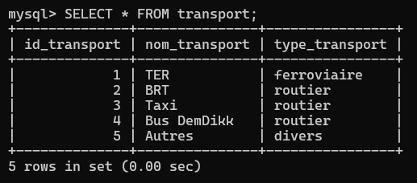

## Table Station

```sql
-- Création de la table Station
CREATE TABLE IF NOT EXISTS Station (
    id_station INT AUTO_INCREMENT PRIMARY KEY,
    nom_station VARCHAR(100) NOT NULL,
    localisation VARCHAR(100) NOT NULL);
```

### **Affichage de la table en naturel  :**

| id_station | nom_station | localisation |
| --- | --- | --- |
| 1 | Gare de Dakar | Dakar |
| 2 | Gare de Diamniadio | Diamniadio |
| 3 | Station BRT Liberté 5 | Dakar |
| 4 | Station BRT Guédiawaye | Guédiawaye |
| 5 | Gare de Colobane | Colobane |
| 6 | Gare de Hann | Hann |
| 7 | Gare de Dalifort | Dalifort |
| 8 | Gare de Pikine | Pikine |
| 9 | Gare de Thiaroye | Thiaroye |
| 10 | Station BRT Collège Sacré-Cœur | Dakar |
| 11 | Gare de Rufisque | Rufisque |
| 12 | Station BRT Grand Médine | Dakar |
| 13 | Station BRT Grand Yoff | Dakar |
| 14 | Gare de Bargny | Bargny |
| 15 | Gare de Mbao | Mbao |

### Affichage de la table sur MySQL CommandLine :

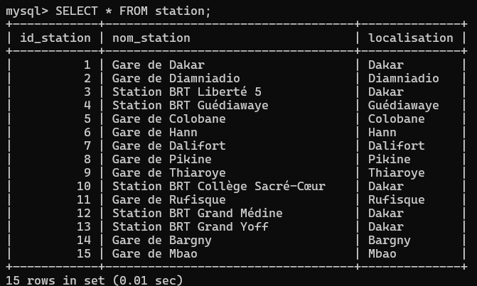

## Table Trajet

```sql
-- Table Trajet
CREATE TABLE IF NOT EXISTS Trajet (
    id_trajet INT AUTO_INCREMENT PRIMARY KEY,
    id_utilisateur INT NOT NULL,
    id_transport INT NOT NULL,
    id_station_depart INT NOT NULL,
    id_station_arrivee INT NOT NULL,
    date_trajet DATETIME NOT NULL,
    nom_lieu_depart VARCHAR(50) NOT NULL,
    nom_lieu_arrivee VARCHAR(50) NOT NULL,
    heure_depart TIME NOT NULL,
    heure_arrivee TIME NOT NULL,
    FOREIGN KEY (id_utilisateur) REFERENCES Utilisateur(id_utilisateur),
    FOREIGN KEY (id_transport) REFERENCES Transport(id_transport),
    FOREIGN KEY (id_station_depart) REFERENCES Station(id_station),
    FOREIGN KEY (id_station_arrivee) REFERENCES Station(id_station)
);
```

### Affichage de la table en naturel :

| id_trajet | id_utilisateur | id_transport | id_station_depart | id_station_arrivee | date_trajet | nom_lieu_depart | nom_lieu_arrivee | heure_depart | heure_arrivee |
| --- | --- | --- | --- | --- | --- | --- | --- | --- | --- |
| 1 | 1 | 2 | 4 | 10 | 10 juillet 2023 21:52 | Station BRT Guédiawaye | Station BRT Collège Sacré-Cœur | 21:52:00 | 22:37:00 |
| 2 | 2 | 2 | 4 | 3 | 28 décembre 2024 02:42 | Station BRT Guédiawaye | Station BRT Liberté 5 | 02:42:00 | 03:27:00 |
| 3 | 2 | 1 | 15 | 1 | 3 février 2024 14:18 | Gare de Mbao | Gare de Dakar | 14:18:00 | 14:48:00 |
| 4 | 2 | 2 | 4 | 3 | 3 juillet 2024 03:59 | Station BRT Guédiawaye | Station BRT Liberté 5 | 03:59:00 | 04:44:00 |
| 5 | 2 | 2 | 4 | 13 | 21 octobre 2023 00:59 | Station BRT Guédiawaye | Station BRT Grand Yoff | 00:59:00 | 01:44:00 |
| 6 | 2 | 1 | 1 | 5 | 17 septembre 2024 01:53 | Gare de Dakar | Gare de Colobane | 01:53:00 | 02:23:00 |
| 7 | 3 | 2 | 10 | 3 | 19 mars 2024 15:53 | Station BRT Collège Sacré-Cœur | Station BRT Liberté 5 | 15:53:00 | 16:38:00 |
| 8 | 3 | 2 | 10 | 4 | 30 novembre 2023 08:33 | Station BRT Collège Sacré-Cœur | Station BRT Guédiawaye | 08:33:00 | 09:18:00 |
| 9 | 3 | 1 | 1 | 14 | 21 février 2023 01:02 | Gare de Dakar | Gare de Bargny | 01:02:00 | 01:32:00 |
| 10 | 3 | 2 | 4 | 3 | 30 juin 2023 20:51 | Station BRT Guédiawaye | Station BRT Liberté 5 | 20:51:00 | 21:36:00 |
| 11 | 3 | 2 | 3 | 4 | 28 novembre 2024 11:03 | Station BRT Liberté 5 | Station BRT Guédiawaye | 11:03:00 | 11:48:00 |
| 12 | 4 | 1 | 1 | 2 | 8 juin 2024 10:00 | Gare de Dakar | Gare de Diamniadio | 10:00:00 | 10:30:00 |
| 13 | 4 | 2 | 3 | 12 | 31 mai 2024 19:34 | Station BRT Liberté 5 | Station BRT Grand Médine | 19:34:00 | 20:19:00 |
| 14 | 4 | 2 | 3 | 4 | 30 juin 2023 17:50 | Station BRT Liberté 5 | Station BRT Guédiawaye | 17:50:00 | 18:35:00 |
| 15 | 4 | 1 | 2 | 6 | 2 avril 2024 22:17 | Gare de Diamniadio | Gare de Hann | 22:17:00 | 22:47:00 |
| 16 | 5 | 2 | 3 | 4 | 16 janvier 2024 11:10 | Station BRT Liberté 5 | Station BRT Guédiawaye | 11:10:00 | 11:55:00 |
| 17 | 5 | 2 | 3 | 13 | 25 avril 2024 11:45 | Station BRT Liberté 5 | Station BRT Grand Yoff | 11:45:00 | 12:30:00 |
| 18 | 5 | 1 | 1 | 14 | 8 février 2024 03:46 | Gare de Dakar | Gare de Bargny | 03:46:00 | 04:16:00 |
| 19 | 5 | 2 | 4 | 12 | 11 octobre 2023 09:59 | Station BRT Guédiawaye | Station BRT Grand Médine | 09:59:00 | 10:44:00 |
| 20 | 6 | 2 | 4 | 3 | 15 mars 2023 23:12 | Station BRT Guédiawaye | Station BRT Liberté 5 | 23:12:00 | 23:57:00 |
| 21 | 6 | 1 | 2 | 14 | 9 février 2024 21:00 | Gare de Diamniadio | Gare de Bargny | 21:00:00 | 21:30:00 |
| 22 | 7 | 2 | 4 | 3 | 27 avril 2024 06:19 | Station BRT Guédiawaye | Station BRT Liberté 5 | 06:19:00 | 07:04:00 |
| 23 | 7 | 2 | 3 | 10 | 26 septembre 2024 06:06 | Station BRT Liberté 5 | Station BRT Collège Sacré-Cœur | 06:06:00 | 06:51:00 |
| 24 | 7 | 1 | 2 | 8 | 27 janvier 2024 08:06 | Gare de Diamniadio | Gare de Pikine | 08:06:00 | 08:36:00 |
| 25 | 7 | 2 | 4 | 10 | 23 janvier 2024 01:58 | Station BRT Guédiawaye | Station BRT Collège Sacré-Cœur | 01:58:00 | 02:43:00 |
| 26 | 7 | 2 | 3 | 4 | 24 octobre 2024 22:26 | Station BRT Liberté 5 | Station BRT Guédiawaye | 22:26:00 | 23:11:00 |
| 27 | 8 | 1 | 2 | 9 | 26 août 2023 07:28 | Gare de Diamniadio | Gare de Thiaroye | 07:28:00 | 07:58:00 |
| 28 | 8 | 2 | 4 | 3 | 27 janvier 2024 05:33 | Station BRT Guédiawaye | Station BRT Liberté 5 | 05:33:00 | 06:18:00 |
| 29 | 8 | 2 | 4 | 10 | 25 février 2023 17:21 | Station BRT Guédiawaye | Station BRT Collège Sacré-Cœur | 17:21:00 | 18:06:00 |
| 30 | 9 | 1 | 6 | 1 | 31 mars 2024 01:24 | Gare de Hann | Gare de Dakar | 01:24:00 | 01:54:00 |
| 31 | 10 | 2 | 3 | 4 | 9 septembre 2024 18:34 | Station BRT Liberté 5 | Station BRT Guédiawaye | 18:34:00 | 19:19:00 |
| 32 | 10 | 2 | 4 | 3 | 19 août 2024 22:19 | Station BRT Guédiawaye | Station BRT Liberté 5 | 22:19:00 | 23:04:00 |
| 33 | 10 | 1 | 6 | 1 | 3 mars 2024 22:54 | Gare de Hann | Gare de Dakar | 22:54:00 | 23:24:00 |
| 34 | 10 | 2 | 10 | 4 | 28 juin 2024 06:45 | Station BRT Collège Sacré-Cœur | Station BRT Guédiawaye | 06:45:00 | 07:30:00 |
| 35 | 11 | 2 | 4 | 3 | 17 juillet 2024 10:40 | Station BRT Guédiawaye | Station BRT Liberté 5 | 10:40:00 | 11:25:00 |
| 36 | 11 | 1 | 2 | 1 | 5 mars 2024 20:46 | Gare de Diamniadio | Gare de Dakar | 20:46:00 | 21:16:00 |
| 37 | 11 | 2 | 4 | 3 | 11 mai 2023 03:10 | Station BRT Guédiawaye | Station BRT Liberté 5 | 03:10:00 | 03:55:00 |
| 38 | 11 | 2 | 4 | 10 | 22 juillet 2023 03:21 | Station BRT Guédiawaye | Station BRT Collège Sacré-Cœur | 03:21:00 | 04:06:00 |
| 39 | 12 | 1 | 1 | 2 | 14 août 2023 15:19 | Gare de Dakar | Gare de Diamniadio | 15:19:00 | 15:49:00 |
| 40 | 12 | 2 | 3 | 13 | 14 juillet 2023 02:58 | Station BRT Liberté 5 | Station BRT Grand Yoff | 02:58:00 | 03:43:00 |
| 41 | 12 | 2 | 3 | 12 | 5 septembre 2024 00:45 | Station BRT Liberté 5 | Station BRT Grand Médine | 00:45:00 | 01:30:00 |
| 42 | 12 | 1 | 7 | 2 | 28 décembre 2024 17:38 | Gare de Dalifort | Gare de Diamniadio | 17:38:00 | 18:08:00 |
| 43 | 13 | 2 | 4 | 13 | 24 janvier 2023 20:04 | Station BRT Guédiawaye | Station BRT Grand Yoff | 20:04:00 | 20:49:00 |
| 44 | 13 | 2 | 3 | 4 | 25 mai 2024 06:09 | Station BRT Liberté 5 | Station BRT Guédiawaye | 06:09:00 | 06:54:00 |
| 45 | 13 | 1 | 2 | 5 | 21 janvier 2023 14:14 | Gare de Diamniadio | Gare de Colobane | 14:14:00 | 14:44:00 |
| 46 | 13 | 2 | 4 | 3 | 4 juillet 2023 06:46 | Station BRT Guédiawaye | Station BRT Liberté 5 | 06:46:00 | 07:31:00 |
| 47 | 13 | 2 | 10 | 3 | 30 septembre 2023 12:31 | Station BRT Collège Sacré-Cœur | Station BRT Liberté 5 | 12:31:00 | 13:16:00 |
| 48 | 14 | 1 | 1 | 15 | 4 février 2023 15:08 | Gare de Dakar | Gare de Mbao | 15:08:00 | 15:38:00 |
| 49 | 14 | 2 | 3 | 10 | 7 juin 2024 20:43 | Station BRT Liberté 5 | Station BRT Collège Sacré-Cœur | 20:43:00 | 21:28:00 |
| 50 | 14 | 2 | 3 | 12 | 11 mars 2023 06:12 | Station BRT Liberté 5 | Station BRT Grand Médine | 06:12:00 | 06:57:00 |
| 51 | 14 | 1 | 5 | 1 | 11 mai 2023 18:41 | Gare de Colobane | Gare de Dakar | 18:41:00 | 19:11:00 |
| 52 | 15 | 2 | 4 | 10 | 4 juin 2024 18:20 | Station BRT Guédiawaye | Station BRT Collège Sacré-Cœur | 18:20:00 | 19:05:00 |
| 53 | 15 | 2 | 3 | 4 | 11 juin 2023 01:44 | Station BRT Liberté 5 | Station BRT Guédiawaye | 01:44:00 | 02:29:00 |
| 54 | 16 | 1 | 15 | 1 | 30 novembre 2023 06:57 | Gare de Mbao | Gare de Dakar | 06:57:00 | 07:27:00 |
| 55 | 16 | 2 | 4 | 3 | 2 avril 2024 03:16 | Station BRT Guédiawaye | Station BRT Liberté 5 | 03:16:00 | 04:01:00 |
| 56 | 16 | 2 | 4 | 3 | 2 mai 2024 06:36 | Station BRT Guédiawaye | Station BRT Liberté 5 | 06:36:00 | 07:21:00 |
| 57 | 16 | 1 | 2 | 6 | 8 décembre 2023 19:11 | Gare de Diamniadio | Gare de Hann | 19:11:00 | 19:41:00 |
| 58 | 17 | 2 | 3 | 4 | 16 octobre 2023 10:51 | Station BRT Liberté 5 | Station BRT Guédiawaye | 10:51:00 | 11:36:00 |
| 59 | 17 | 2 | 4 | 12 | 26 janvier 2023 21:00 | Station BRT Guédiawaye | Station BRT Grand Médine | 21:00:00 | 21:45:00 |
| 60 | 17 | 1 | 2 | 1 | 20 avril 2023 11:13 | Gare de Diamniadio | Gare de Dakar | 11:13:00 | 11:43:00 |
| 61 | 18 | 2 | 3 | 13 | 30 novembre 2024 02:34 | Station BRT Liberté 5 | Station BRT Grand Yoff | 02:34:00 | 03:19:00 |
| 62 | 19 | 2 | 3 | 4 | 14 mars 2024 00:34 | Station BRT Liberté 5 | Station BRT Guédiawaye | 00:34:00 | 01:19:00 |
| 63 | 19 | 1 | 2 | 6 | 15 février 2023 20:42 | Gare de Diamniadio | Gare de Hann | 20:42:00 | 21:12:00 |
| 64 | 20 | 2 | 4 | 10 | 25 juillet 2024 13:39 | Station BRT Guédiawaye | Station BRT Collège Sacré-Cœur | 13:39:00 | 14:24:00 |
| 65 | 20 | 2 | 3 | 12 | 1 octobre 2024 16:26 | Station BRT Liberté 5 | Station BRT Grand Médine | 16:26:00 | 17:11:00 |
| 66 | 20 | 1 | 1 | 14 | 20 décembre 2024 08:58 | Gare de Dakar | Gare de Bargny | 08:58:00 | 09:28:00 |
| 67 | 20 | 2 | 3 | 4 | 31 mars 2023 23:02 | Station BRT Liberté 5 | Station BRT Guédiawaye | 23:02:00 | 23:47:00 |
| 68 | 21 | 2 | 3 | 4 | 18 mai 2023 16:23 | Station BRT Liberté 5 | Station BRT Guédiawaye | 16:23:00 | 17:08:00 |
| 69 | 21 | 1 | 2 | 1 | 26 mars 2024 05:34 | Gare de Diamniadio | Gare de Dakar | 05:34:00 | 06:04:00 |
| 70 | 22 | 2 | 3 | 4 | 19 juin 2023 17:26 | Station BRT Liberté 5 | Station BRT Guédiawaye | 17:26:00 | 18:11:00 |
| 71 | 22 | 2 | 3 | 13 | 23 novembre 2024 09:10 | Station BRT Liberté 5 | Station BRT Grand Yoff | 09:10:00 | 09:55:00 |
| 72 | 22 | 1 | 1 | 2 | 4 mai 2024 19:05 | Gare de Dakar | Gare de Diamniadio | 19:05:00 | 19:35:00 |
| 73 | 23 | 2 | 10 | 4 | 15 décembre 2024 15:13 | Station BRT Collège Sacré-Cœur | Station BRT Guédiawaye | 15:13:00 | 15:58:00 |
| 74 | 23 | 2 | 3 | 4 | 11 juin 2023 10:30 | Station BRT Liberté 5 | Station BRT Guédiawaye | 10:30:00 | 11:15:00 |
| 75 | 23 | 1 | 15 | 2 | 7 juillet 2023 00:56 | Gare de Mbao | Gare de Diamniadio | 00:56:00 | 01:26:00 |
| 76 | 23 | 2 | 4 | 13 | 30 novembre 2023 18:01 | Station BRT Guédiawaye | Station BRT Grand Yoff | 18:01:00 | 18:46:00 |
| 77 | 23 | 2 | 3 | 10 | 28 mai 2024 04:01 | Station BRT Liberté 5 | Station BRT Collège Sacré-Cœur | 04:01:00 | 04:46:00 |
| 78 | 24 | 1 | 2 | 7 | 20 août 2024 18:44 | Gare de Diamniadio | Gare de Dalifort | 18:44:00 | 19:14:00 |
| 79 | 24 | 2 | 4 | 12 | 17 février 2024 08:21 | Station BRT Guédiawaye | Station BRT Grand Médine | 08:21:00 | 09:06:00 |
| 80 | 24 | 2 | 4 | 10 | 27 décembre 2024 03:22 | Station BRT Guédiawaye | Station BRT Collège Sacré-Cœur | 03:22:00 | 04:07:00 |
| 81 | 24 | 1 | 1 | 14 | 17 juin 2023 01:31 | Gare de Dakar | Gare de Bargny | 01:31:00 | 02:01:00 |
| 82 | 24 | 2 | 3 | 4 | 20 janvier 2024 00:36 | Station BRT Liberté 5 | Station BRT Guédiawaye | 00:36:00 | 01:21:00 |
| 83 | 25 | 2 | 3 | 10 | 19 octobre 2024 16:46 | Station BRT Liberté 5 | Station BRT Collège Sacré-Cœur | 16:46:00 | 17:31:00 |
| 84 | 25 | 1 | 1 | 8 | 20 août 2024 13:15 | Gare de Dakar | Gare de Pikine | 13:15:00 | 13:45:00 |
| 85 | 25 | 2 | 3 | 10 | 2 février 2023 04:09 | Station BRT Liberté 5 | Station BRT Collège Sacré-Cœur | 04:09:00 | 04:54:00 |
| 86 | 25 | 2 | 4 | 3 | 1 novembre 2023 10:47 | Station BRT Guédiawaye | Station BRT Liberté 5 | 10:47:00 | 11:32:00 |
| 87 | 26 | 1 | 2 | 15 | 21 mars 2023 22:37 | Gare de Diamniadio | Gare de Mbao | 22:37:00 | 23:07:00 |
| 88 | 26 | 2 | 3 | 13 | 16 janvier 2024 00:09 | Station BRT Liberté 5 | Station BRT Grand Yoff | 00:09:00 | 00:54:00 |
| 89 | 27 | 2 | 10 | 3 | 8 mars 2024 18:33 | Station BRT Collège Sacré-Cœur | Station BRT Liberté 5 | 18:33:00 | 19:18:00 |
| 90 | 28 | 1 | 2 | 1 | 14 octobre 2023 00:13 | Gare de Diamniadio | Gare de Dakar | 00:13:00 | 00:43:00 |
| 91 | 28 | 2 | 4 | 10 | 19 août 2023 21:27 | Station BRT Guédiawaye | Station BRT Collège Sacré-Cœur | 21:27:00 | 22:12:00 |
| 92 | 28 | 2 | 4 | 13 | 23 avril 2024 15:30 | Station BRT Guédiawaye | Station BRT Grand Yoff | 15:30:00 | 16:15:00 |
| 93 | 29 | 1 | 2 | 1 | 3 septembre 2024 10:50 | Gare de Diamniadio | Gare de Dakar | 10:50:00 | 11:20:00 |
| 94 | 29 | 2 | 13 | 4 | 13 mai 2023 09:25 | Station BRT Grand Yoff | Station BRT Guédiawaye | 09:25:00 | 10:10:00 |
| 95 | 29 | 2 | 3 | 4 | 14 décembre 2024 02:59 | Station BRT Liberté 5 | Station BRT Guédiawaye | 02:59:00 | 03:44:00 |
| 96 | 29 | 1 | 1 | 7 | 19 mai 2023 09:19 | Gare de Dakar | Gare de Dalifort | 09:19:00 | 09:49:00 |
| 97 | 29 | 2 | 4 | 3 | 8 mai 2024 03:02 | Station BRT Guédiawaye | Station BRT Liberté 5 | 03:02:00 | 03:47:00 |
| 98 | 30 | 2 | 3 | 12 | 11 novembre 2024 20:00 | Station BRT Liberté 5 | Station BRT Grand Médine | 20:00:00 | 20:45:00 |
| 99 | 30 | 1 | 2 | 1 | 7 septembre 2023 10:25 | Gare de Diamniadio | Gare de Dakar | 10:25:00 | 10:55:00 |
| 100 | 31 | 2 | 4 | 13 | 7 mars 2023 04:29 | Station BRT Guédiawaye | Station BRT Grand Yoff | 04:29:00 | 05:14:00 |
| 101 | 32 | 2 | 3 | 10 | 7 janvier 2023 13:48 | Station BRT Liberté 5 | Station BRT Collège Sacré-Cœur | 13:48:00 | 14:33:00 |
| 102 | 32 | 1 | 2 | 8 | 14 août 2023 21:46 | Gare de Diamniadio | Gare de Pikine | 21:46:00 | 22:16:00 |
| 103 | 32 | 2 | 4 | 12 | 8 décembre 2023 17:35 | Station BRT Guédiawaye | Station BRT Grand Médine | 17:35:00 | 18:20:00 |
| 104 | 33 | 2 | 4 | 3 | 14 novembre 2024 05:48 | Station BRT Guédiawaye | Station BRT Liberté 5 | 05:48:00 | 06:33:00 |
| 105 | 33 | 1 | 2 | 14 | 4 juillet 2023 07:28 | Gare de Diamniadio | Gare de Bargny | 07:28:00 | 07:58:00 |
| 106 | 33 | 2 | 3 | 4 | 12 août 2024 22:44 | Station BRT Liberté 5 | Station BRT Guédiawaye | 22:44:00 | 23:29:00 |
| 107 | 33 | 2 | 4 | 13 | 3 septembre 2024 05:10 | Station BRT Guédiawaye | Station BRT Grand Yoff | 05:10:00 | 05:55:00 |
| 108 | 34 | 1 | 2 | 11 | 19 février 2023 19:51 | Gare de Diamniadio | Gare de Rufisque | 19:51:00 | 20:21:00 |
| 109 | 34 | 2 | 4 | 3 | 26 septembre 2024 02:10 | Station BRT Guédiawaye | Station BRT Liberté 5 | 02:10:00 | 02:55:00 |
| 110 | 34 | 2 | 12 | 3 | 9 mars 2024 04:27 | Station BRT Grand Médine | Station BRT Liberté 5 | 04:27:00 | 05:12:00 |
| 111 | 34 | 1 | 1 | 14 | 2 novembre 2024 05:27 | Gare de Dakar | Gare de Bargny | 05:27:00 | 05:57:00 |
| 112 | 34 | 2 | 4 | 3 | 22 février 2024 07:39 | Station BRT Guédiawaye | Station BRT Liberté 5 | 07:39:00 | 08:24:00 |
| 113 | 35 | 2 | 4 | 3 | 1 octobre 2024 03:20 | Station BRT Guédiawaye | Station BRT Liberté 5 | 03:20:00 | 04:05:00 |
| 114 | 35 | 1 | 1 | 15 | 27 janvier 2024 14:36 | Gare de Dakar | Gare de Mbao | 14:36:00 | 15:06:00 |
| 115 | 35 | 2 | 4 | 3 | 9 avril 2023 20:46 | Station BRT Guédiawaye | Station BRT Liberté 5 | 20:46:00 | 21:31:00 |
| 116 | 35 | 2 | 4 | 12 | 3 septembre 2023 09:52 | Station BRT Guédiawaye | Station BRT Grand Médine | 09:52:00 | 10:37:00 |
| 117 | 35 | 1 | 11 | 2 | 9 juillet 2023 15:32 | Gare de Rufisque | Gare de Diamniadio | 15:32:00 | 16:02:00 |
| 118 | 36 | 2 | 4 | 12 | 14 juin 2024 06:48 | Station BRT Guédiawaye | Station BRT Grand Médine | 06:48:00 | 07:33:00 |
| 119 | 36 | 2 | 12 | 4 | 28 janvier 2023 18:44 | Station BRT Grand Médine | Station BRT Guédiawaye | 18:44:00 | 19:29:00 |
| 120 | 37 | 1 | 1 | 2 | 25 septembre 2023 22:02 | Gare de Dakar | Gare de Diamniadio | 22:02:00 | 22:32:00 |
| 121 | 37 | 2 | 3 | 4 | 3 août 2023 02:54 | Station BRT Liberté 5 | Station BRT Guédiawaye | 02:54:00 | 03:39:00 |
| 122 | 37 | 2 | 3 | 4 | 14 décembre 2023 09:47 | Station BRT Liberté 5 | Station BRT Guédiawaye | 09:47:00 | 10:32:00 |
| 123 | 38 | 1 | 2 | 6 | 28 janvier 2023 19:55 | Gare de Diamniadio | Gare de Hann | 19:55:00 | 20:25:00 |
| 124 | 39 | 2 | 4 | 3 | 24 juin 2023 03:13 | Station BRT Guédiawaye | Station BRT Liberté 5 | 03:13:00 | 03:58:00 |
| 125 | 39 | 2 | 4 | 3 | 21 novembre 2024 08:30 | Station BRT Guédiawaye | Station BRT Liberté 5 | 08:30:00 | 09:15:00 |
| 126 | 39 | 1 | 2 | 1 | 9 août 2023 07:07 | Gare de Diamniadio | Gare de Dakar | 07:07:00 | 07:37:00 |
| 127 | 39 | 2 | 3 | 10 | 6 avril 2024 12:55 | Station BRT Liberté 5 | Station BRT Collège Sacré-Cœur | 12:55:00 | 13:40:00 |
| 128 | 40 | 2 | 4 | 3 | 14 septembre 2023 17:46 | Station BRT Guédiawaye | Station BRT Liberté 5 | 17:46:00 | 18:31:00 |
| 129 | 40 | 1 | 9 | 1 | 20 décembre 2024 08:01 | Gare de Thiaroye | Gare de Dakar | 08:01:00 | 08:31:00 |

### Affichage sur MySQL CommandLine :

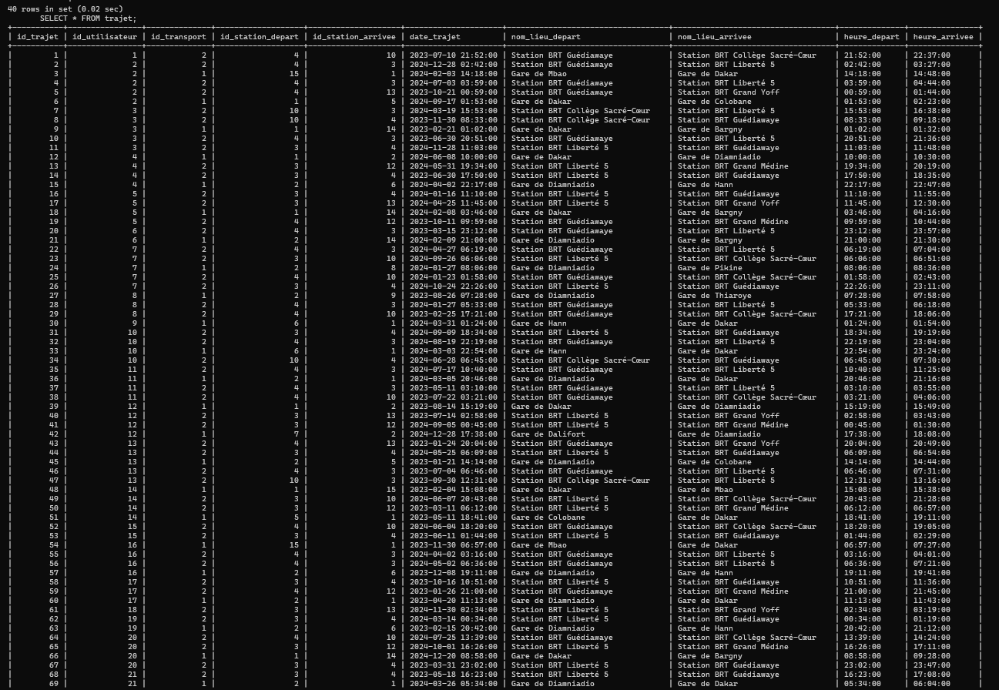

## Table Enquete

```sql
-- Création de la table enquete
CREATE TABLE IF NOT EXISTS Enquete (
    id_enquete INT AUTO_INCREMENT PRIMARY KEY,
    id_utilisateur INT NOT NULL,
    satisfaction INT NOT NULL,
    commentaires TEXT,
    date_reponse DATE NOT NULL,
    FOREIGN KEY (id_utilisateur) REFERENCES Utilisateur(id_utilisateur)
);
```

### Affichage de la table en naturel :

| id_enquete  | id_utilisateur  | satisfaction  | commentaires                                                                                                    | date_reponse |
| --- | --- | --- | --- | --- |
| 1 | 1 | 9 | J'ai trouvé le BRT très efficace pour mes déplacements quotidiens. Les bus sont modernes et bien entretenus. | 9 janvier 2024 |
| 2 | 2 | 10 | Le TER est une excellente alternative aux taxis. Le service est ponctuel et les wagons sont propres. | 26 août 2024 |
| 3 | 3 | 9 | Le BRT m'a permis de gagner du temps sur mon trajet. Les arrêts sont bien situés et le service est régulier. | 22 juin 2024 |
| 4 | 4 | 8 | Le TER offre une belle vue sur la ville pendant le trajet. C'est un moyen de transport que je recommande. | 20 mai 2024 |
| 5 | 5 | 5 | Le TER est souvent en retard aux heures de pointe, ce qui est frustrant. | 18 août 2024 |
| 6 | 6 | 6 | Le BRT est parfois bondé et il est difficile de trouver une place assise. | 23 septembre 2024 |
| 7 | 7 | 7 | Le TER pourrait être plus fréquent, surtout le matin. | 5 novembre 2023 |
| 8 | 8 | 8 | Le BRT manque de ponctualité, ce qui complique la planification de mes trajets. | 10 juin 2024 |
| 9 | 9 | 7 | Le TER est confortable, mais les tarifs sont un peu élevés. | 11 décembre 2023 |
| 10 | 10 | 6 | Le TER est une option correcte pour se déplacer, mais il y a des améliorations à faire. | 4 septembre 2024 |
| 11 | 11 | 6 | Le BRT est pratique, mais il y a parfois des retards. | 9 mai 2024 |
| 12 | 12 | 8 | Le TER est propre, mais il pourrait y avoir plus de fréquences. | 18 août 2024 |
| 13 | 13 | 8 | Le BRT est une bonne alternative, mais il y a des jours où le service est moins fiable. | 23 septembre 2024 |
| 14 | 14 | 9 | Le TER est une solution acceptable pour éviter les embouteillages. | 13 mai 2024 |
| 15 | 15 | 10 | J'aime prendre le TER pour aller au travail, c'est rapide et pratique. | 22 janvier 2024 |
| 16 | 16 | 10 | Le BRT est mon moyen de transport préféré pour les trajets en ville. | 14 novembre 2023 |
| 17 | 17 | 9 | Le TER me permet de lire tranquillement pendant le trajet. | 23 janvier 2024 |
| 18 | 18 | 10 | Le BRT est idéal pour mes déplacements quotidiens, surtout aux heures de pointe. | 17 juillet 2024 |
| 19 | 19 | 10 | Le TER est parfait pour mes trajets du week-end, j'apprécie la tranquillité. | 27 mai 2024 |
| 20 | 20 | 9 | Le TER est très pratique pour éviter les embouteillages de Dakar. Le trajet est rapide et confortable. | 16 février 2024 |
| 21 | 21 | 9 | J'ai trouvé le BRT très efficace pour mes déplacements quotidiens. Les bus sont modernes et bien entretenus. | 26 décembre 2023 |
| 22 | 22 | 10 | Le TER est une excellente alternative aux taxis. Le service est ponctuel et les wagons sont propres. | 21 juillet 2024 |
| 23 | 23 | 8 | Le BRT m'a permis de gagner du temps sur mon trajet. Les arrêts sont bien situés et le service est régulier. | 5 août 2024 |
| 24 | 24 | 10 | Le TER offre une belle vue sur la ville pendant le trajet. C'est un moyen de transport que je recommande. | 3 avril 2024 |
| 25 | 25 | 3 | Le TER est souvent en retard aux heures de pointe, ce qui est frustrant. | 4 septembre 2024 |
| 26 | 26 | 4 | Le BRT est parfois bondé et il est difficile de trouver une place assise. | 15 février 2024 |
| 27 | 27 | 5 | Le TER pourrait être plus fréquent, surtout le matin. | 25 septembre 2024 |
| 28 | 28 | 4 | Le BRT manque de ponctualité, ce qui complique la planification de mes trajets. | 28 mai 2024 |
| 29 | 29 | 7 | Le TER est confortable, mais les tarifs sont un peu élevés. | 11 janvier 2024 |
| 30 | 30 | 8 | Le TER est une option correcte pour se déplacer, mais il y a des améliorations à faire. | 2 juillet 2024 |
| 31 | 31 | 6 | Le BRT est pratique, mais il y a parfois des retards. | 24 octobre 2023 |
| 32 | 32 | 8 | Le TER est propre, mais il pourrait y avoir plus de fréquences. | 24 mars 2024 |
| 33 | 33 | 7 | Le BRT est une bonne alternative, mais il y a des jours où le service est moins fiable. | 25 mars 2024 |
| 34 | 34 | 6 | Le TER est une solution acceptable pour éviter les embouteillages. | 31 mai 2024 |
| 35 | 35 | 9 | J'aime prendre le TER pour aller au travail, c'est rapide et pratique. | 21 décembre 2023 |
| 36 | 36 | 10 | Le BRT est mon moyen de transport préféré pour les trajets en ville. | 22 janvier 2024 |
| 37 | 37 | 8 | Le TER me permet de lire tranquillement pendant le trajet. | 7 mars 2024 |
| 38 | 38 | 9 | Le BRT est idéal pour mes déplacements quotidiens, surtout aux heures de pointe. | 22 août 2024 |
| 39 | 39 | 9 | Le TER est parfait pour mes trajets du week-end, j'apprécie la tranquillité. | 3 septembre 2024 |
| 40 | 40 | 8 | Le TER est très pratique pour éviter les embouteillages de Dakar. Le trajet est rapide et confortable. | 7 février 2024 |

---

# **4. Analyse et manipulation des données de la base**

### **4.1. Requêtes SQL pour l’Analyse des Données**

> Voici une série de **requêtes SQL** qui vont nous permettre **d’analyser les données de la base et d’en extraire des informations utiles** pour l’entreprise.
> 

## **Nombre total d’utilisateurs par type (élève, personnel prof)**

```sql
SELECT type_utilisateur, COUNT(*) AS nombre_utilisateurs
FROM Utilisateur
GROUP BY type_utilisateur;
```

### **Explication** :

- Cette requête permet de connaître le nombre total d’utilisateurs répartis par type d’usager (élève, personnel, etc.).

**Exemples d’application** :

1. **Amélioration des services** : Adapter les offres de services en fonction du profil des utilisateurs (ex : réductions pour les étudiants).
2. **Analyse de l’audience** : Mieux cibler les utilisateurs par profil pour des campagnes d’information.
3. **Planification des trajets** : Ajuster les horaires de transports pour répondre aux besoins spécifiques des élèves et du personnel.

---

## Nombre total de trajets

```sql
SELECT COUNT(*) AS nombre_tra_total
FROM trajet;

```

### Explication :

- Cette requête affiche le nombre total de trajets réalisés, fournissant une vision d’ensemble sur l’activité de transport.

### Exemples d’application :

1. **Indicateur de performance** : Suivre l’activité générale du service de transport.
2. **Prévision de la demande** : Utiliser le total des trajets pour prévoir la demande future.
3. **Planification des ressources** : Ajuster les ressources en fonction du nombre total de trajets.

---

## Trajet le plus récent et le plus ancien

```sql
SELECT MAX(date_trajet) as Plus_récent, MIN(date_trajet) AS Plus_ancient
FROM trajet;

```

### Explication :

- Cette requête renvoie la date du trajet le plus récent et du plus ancien dans les données, permettant de comprendre l’étendue de la période d’analyse.

### Exemples d’application :

1. **Définir la période d’étude** : Déterminer les limites temporelles pour l’analyse des trajets.
2. **Analyse des tendances** : Comparer les trajets effectués récemment avec ceux du passé.
3. **Historique des trajets** : Suivre l’évolution des trajets sur une longue période.

---

## **Trajets récents (effectués dans les 30 derniers jours)**

```sql
SELECT Utilisateur.nom, Utilisateur.prenom, Trajet.date_trajet
FROM Utilisateur
JOIN Trajet ON Utilisateur.id_utilisateur = Trajet.id_utilisateur
WHERE Trajet.date_trajet >= CURDATE() - INTERVAL 30 DAY
ORDER BY Trajet.date_trajet DESC;
```

### **Explication** :

- Cette requête permet de consulter les trajets les plus récents, limités aux 30 derniers jours, pour une analyse de la fréquentation actuelle.

**Exemples d’application** :

1. **Analyse des tendances récentes** : Observer les trajets récents pour évaluer les tendances de fréquentation.
2. **Événements saisonniers** : Ajuster les ressources en cas de forte demande (ex : rentrée scolaire).
3. **Planification rapide** : Prendre des décisions à court terme en fonction des tendances d’utilisation récentes.

---

## Moyenne de trajets par utilisateur sur la période d'étude

```sql
SELECT AVG(nombre_trajets) AS moyenne_trajets_par_utilisateur
FROM (
    SELECT COUNT(Trajet.id_trajet) AS nombre_trajets
    FROM Trajet
    GROUP BY Trajet.id_utilisateur
) AS sous_requete;

```

### Explication :

- Cette requête calcule le nombre moyen de trajets par utilisateur, indiquant la fréquence d’utilisation des services de transport.

### Exemples d’application :

1. **Segmentation des utilisateurs** : Distinguer les utilisateurs réguliers des occasionnels.
2. **Programmes de fidélisation** : Encourager les utilisateurs moins actifs à utiliser les services de transport.
3. **Rapport de fréquentation** : Évaluer la popularité des transports publics.

---

## **Répartition des transports utilisés**

```sql
SELECT Transport.nom_transport, COUNT(Trajet.id_trajet) AS nombre_trajets
FROM Trajet
JOIN Transport ON Trajet.id_transport = Transport.id_transport
GROUP BY Transport.nom_transport;
```

### **Explication** :

- Cette requête permet de connaître le nombre de trajets effectués pour chaque type de transport (TER, BRT, etc.).

**Exemples d’application** :

1. **Optimisation des ressources** : Répartir les ressources selon les types de transport les plus utilisés.
2. **Identification des préférences** : Identifier les types de transport privilégiés pour des campagnes de communication.
3. **Planification des infrastructures** : Prioriser les investissements pour les moyens de transport les plus sollicités.

---

## **Répartition des trajets dans le temps (fréquence par mois)**

```sql
SELECT MONTH(date_trajet) AS mois, COUNT(*) AS nombre_trajets
FROM Trajet
GROUP BY mois
ORDER BY mois;
```

### **Explication** :

- Cette requête permet de connaître la fréquence des trajets par mois, offrant ainsi une vue sur l’évolution saisonnière de l’utilisation des transports.

**Exemples d’application** :

1. **Planification saisonnière** : Adapter l’offre de transport aux pics d’utilisation identifiés.
2. **Prévision des flux** : Anticiper les périodes de forte affluence.
3. **Allocation des ressources** : Adapter les équipes (ex : conducteurs, agents) aux périodes plus fréquentées.

---

## **Répartition des trajets par type d’utilisateur et type de transport**

```sql
SELECT Utilisateur.type_utilisateur, Transport.nom_transport, COUNT(Trajet.id_trajet) AS nombre_trajets
FROM Utilisateur
JOIN Trajet ON Utilisateur.id_utilisateur = Trajet.id_utilisateur
JOIN Transport ON Trajet.id_transport = Transport.id_transport
GROUP BY Utilisateur.type_utilisateur, Transport.nom_transport;
```

### **Explication** :

- Cette requête permet de connaître l’utilisation des différents moyens de transport en fonction des profils d’utilisateurs.

**Exemples d’application** :

1. **Ciblage marketing** : Proposer des offres spécifiques pour les étudiants, le personnel, etc.
2. **Analyse des préférences** : Observer quel type de transport est préféré par chaque groupe d’utilisateur.
3. **Optimisation des trajets** : Adapter les services pour répondre aux besoins des différents profils.

---

## **Nombre moyen de trajets par utilisateur** :

```sql
SELECT AVG(nombre_trajets) AS moyenne_trajets_par_utilisateur
FROM (
    SELECT COUNT(Trajet.id_trajet) AS nombre_trajets
    FROM Trajet
    GROUP BY Trajet.id_utilisateur
) AS sous_requete;
```

### **Explication** :

- Cette requête calcule le nombre moyen de trajets effectués par utilisateur, offrant une vue globale sur la fréquence d’utilisation.

**Exemples d’application** :

1. **Segmentation des utilisateurs** : Distinguer les utilisateurs réguliers des occasionnels.
2. **Programmes d’incitation** : Encourager les utilisateurs moins actifs à utiliser les services de transport.
3. **Rapport de fréquentation** : Évaluer la popularité des transports publics.

---

## **Top 5 des utilisateurs les plus actifs**

```sql
SELECT Utilisateur.nom, Utilisateur.prenom, COUNT(Trajet.id_trajet) AS nombre_trajets
FROM Utilisateur
JOIN Trajet ON Utilisateur.id_utilisateur = Trajet.id_utilisateur
GROUP BY Utilisateur.id_utilisateur
ORDER BY nombre_trajets DESC
LIMIT 5;
```

### **Explication** :

- Cette requête permet de lister les 5 utilisateurs ayant effectué le plus de trajets.

**Exemples d’application** :

1. **Récompenses** : Créer des programmes de fidélisation pour les utilisateurs réguliers.
2. **Étude des comportements** : Analyser le comportement des utilisateurs intensifs pour comprendre leurs besoins spécifiques.
3. **Reconnaissance publique** : Créer des incitations pour encourager une utilisation régulière et promouvoir les transports publics.

---

## Comparaison de l'utilisation BRT vs TER

```sql
SELECT
    CASE
        WHEN tr.nom_transport LIKE '%BRT%' THEN 'BRT'
        WHEN tr.nom_transport LIKE '%TER%' THEN 'TER'
        ELSE 'Autre'
    END AS type_transport,
    COUNT(*) AS nombre_trajets
FROM Transport tr
JOIN Trajet t ON tr.id_transport = t.id_transport
GROUP BY
    CASE
        WHEN tr.nom_transport LIKE '%BRT%' THEN 'BRT'
        WHEN tr.nom_transport LIKE '%TER%' THEN 'TER'
        ELSE 'Autre'
    END;

```

### Explication :

- Cette requête compare l’utilisation entre les transports BRT et TER, en comptant le nombre de trajets pour chaque type.

### Exemples d’application :

1. **Répartition des ressources** : Ajuster les ressources en fonction de la popularité du BRT et du TER.
2. **Planification stratégique** : Décider d’investissements supplémentaires selon l’usage.
3. **Analyse comparative** : Comprendre les raisons pour lesquelles un type est préféré à un autre.

---

## Durée moyenne des trajets par type de transport

```sql
SELECT tr.type_transport AS type_transport,
       AVG(TIMEDIFF(t.heure_arrivee, t.heure_depart)) AS duree_moyenne
FROM Transport tr
JOIN Trajet t ON tr.id_transport = t.id_transport
GROUP BY tr.type_transport;
```

### Explication :

- Cette requête calcule la durée moyenne des trajets pour chaque type de transport, en mesurant le temps écoulé entre le départ et l’arrivée.

### Exemples d’application :

1. **Optimisation des temps de trajet** : Analyser et optimiser les durées de trajet pour chaque type de transport.
2. **Amélioration de la satisfaction client** : Réduire les temps de trajet là où c’est possible pour augmenter la satisfaction.
3. **Évaluation des performances** : Comparer les durées moyennes de trajets pour différents types de transport afin d’identifier des points d'amélioration.

---

## **Pourcentage d’utilisation des différents moyens de transport**

```sql
SELECT Transport.nom_transport,
       (COUNT(Trajet.id_trajet) / (SELECT COUNT(*) FROM Trajet) * 100) AS pourcentage_utilisation
FROM Trajet
JOIN Transport ON Trajet.id_transport = Transport.id_transport
GROUP BY Transport.nom_transport;
```

### **Explication** :

- Cette requête calcule le pourcentage d’utilisation de chaque moyen de transport par rapport au nombre total de trajets, offrant une vue d’ensemble sur la part de marché.

**Exemples d’application** :

1. **Rééquilibrage des moyens de transport** : Redistribuer les ressources pour les moyens de transport moins utilisés.
2. **Campagnes de promotion** : Encourager l’utilisation des transports moins populaires.
3. **Évaluation des investissements** : Identifier les transports ayant le plus fort potentiel de croissance et prioriser les investissements.

---

## Taux de correspondance(s) (utilisateurs utilisant plus d'un type de transport)

```sql
SELECT COUNT(DISTINCT u.id_utilisateur) * 100.0 / (SELECT COUNT(*) FROM Utilisateur) AS taux_correspondance
FROM Utilisateur u
JOIN Trajet t1 ON u.id_utilisateur = t1.id_utilisateur
JOIN Trajet t2 ON u.id_utilisateur = t2.id_utilisateur
JOIN Transport tr1 ON t1.id_transport = tr1.id_transport
JOIN Transport tr2 ON t2.id_transport = tr2.id_transport
WHERE tr1.nom_transport != tr2.nom_transport;

```

### Explication :

- Cette requête calcule le pourcentage d’utilisateurs ayant utilisé plus d'un type de transport. Cela aide à comprendre la proportion d’utilisateurs ayant des correspondances entre différents modes de transport.

### Exemples d’application :

1. **Optimisation des correspondances** : Améliorer les connexions entre différents types de transport pour faciliter les correspondances.
2. **Études sur la multimodalité** : Analyser le comportement des utilisateurs qui combinent plusieurs moyens de transport.
3. **Promotion de l’intermodalité** : Encourager l'utilisation combinée de plusieurs types de transport en offrant des réductions pour des trajets intermodaux.

---

## **Satisfaction moyenne par type de transport**

```sql
SELECT tr.nom_transport AS nom_transport, AVG(e.satisfaction) AS satisfaction_moyenne
FROM Transport tr
JOIN Trajet t ON tr.id_transport = t.id_transport
JOIN Enquete e ON t.id_utilisateur = e.id_utilisateur
GROUP BY tr.nom_transport;
```

### **Explication** :

- Cette requête calcule la satisfaction moyenne des utilisateurs pour chaque type de transport.

**Exemples d’application** :

1. **Amélioration ciblée** : Identifier les types de transport ayant un faible taux de satisfaction et mettre en place des améliorations.
2. **Suivi de la qualité** : Utiliser la satisfaction comme indicateur pour évaluer la qualité du service.
3. **Reporting stratégique** : Utiliser ces données pour rapporter aux parties prenantes les performances et les améliorations nécessaires.

---

## Stations les moins fréquentées

```sql
SELECT s.nom_station, COUNT(*) AS nombre_departs
FROM Station s
LEFT JOIN Trajet t ON s.id_station = t.id_station_depart
GROUP BY s.nom_station
ORDER BY nombre_departs ASC
LIMIT 5;

```

### Explication :

- Cette requête identifie les cinq stations les moins fréquentées, en comptant les départs depuis chaque station.

### Exemples d’application :

1. **Optimisation des coûts** : Réduire les services dans les stations moins fréquentées pour diminuer les coûts.
2. **Amélioration de l’accessibilité** : Investir dans les infrastructures pour attirer plus de passagers.
3. **Redéfinition des itinéraires** : Réviser les trajets pour mieux répondre à la demande.

---

## Analyse des commentaires négatifs

```sql
SELECT e.commentaires, e.satisfaction
FROM Enquete e
WHERE e.satisfaction < 5
LIMIT 20;

```

### Explication :

- Cette requête extrait les commentaires d’utilisateurs ayant donné une note de satisfaction inférieure à 5, permettant d’identifier les retours négatifs.

### Exemples d’application :

1. **Amélioration du service** : Identifier les aspects du service qui génèrent des plaintes.
2. **Analyse des causes de mécontentement** : Comprendre pourquoi certains utilisateurs sont insatisfaits.
3. **Plan d’action correctif** : Mettre en place des actions correctives pour améliorer la satisfaction.

---

## Statistiques globales concernant les utilisateurs et leurs trajets

```sql
SELECT
    COUNT(DISTINCT Utilisateur.id_utilisateur) AS total_utilisateurs,
    COUNT(Trajet.id_trajet) AS total_trajets,
    AVG(Enquete.satisfaction) AS satisfaction_moyenne
FROM Utilisateur
LEFT JOIN Trajet ON Utilisateur.id_utilisateur = Trajet.id_utilisateur
LEFT JOIN Enquete ON Utilisateur.id_utilisateur = Enquete.id_utilisateur;
```

### Explication :

- Cette requête fournit des statistiques globales, comme le nombre total d’utilisateurs, le nombre total de trajets, et la satisfaction moyenne des utilisateurs.

### Exemples d’application :

1. **Rapport de performance** : Fournir des indicateurs clés pour évaluer l'utilisation des services de transport.
2. **Amélioration de la satisfaction client** : Surveiller la satisfaction moyenne pour identifier les périodes de satisfaction basse.
3. **Analyse des utilisateurs** : Comprendre le nombre d'utilisateurs actifs et les comparer avec les trajets réalisés.

---

> **Cela complète l’explication des requêtes. Chacune de ces analyses apporte une valeur unique pour comprendre l’utilisation des services de transport et optimiser l’offre.**
> 

---

# **5. Interprétation et exploitation des résultats de l’analyse : les “KPIs”**

<aside>

L’analyse des données révèle plusieurs aspects clés de l’utilisation des transports publics à Dakar, offrant des informations précieuses pour l'amélioration des services :

[Projet 11 DashboardBI.pdf](/Documentation/Dashboard%20BI%20Projet%2011.pdf)

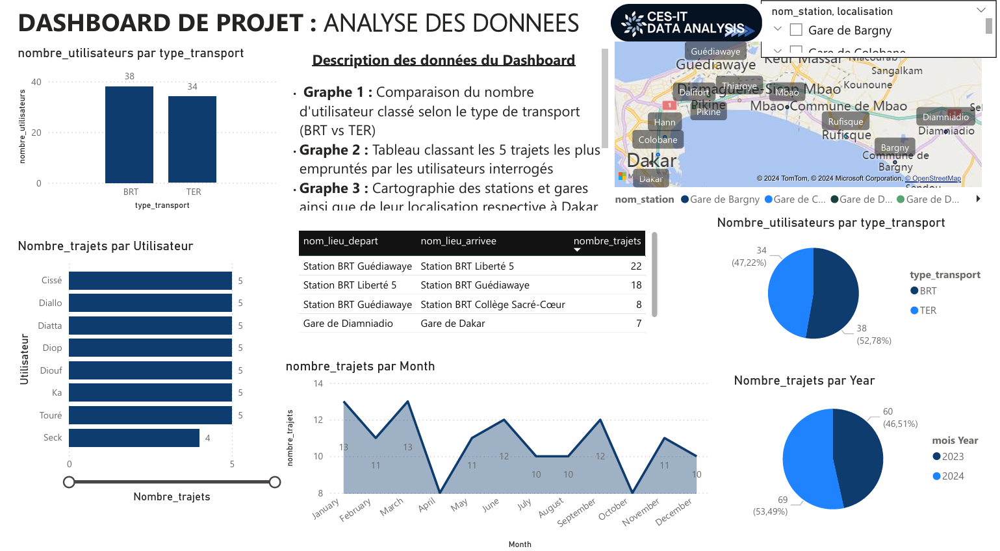

</aside>

1. **Comparaison des utilisateurs selon le type de transport (Graphe 1)**
    
    > Le graphique **compare le nombre d'utilisateurs** des transports BRT et TER, montrant **une légère préférence pour le BRT** avec **38 utilisateurs contre 34 pour le TER**.
    > 
    > 
    > 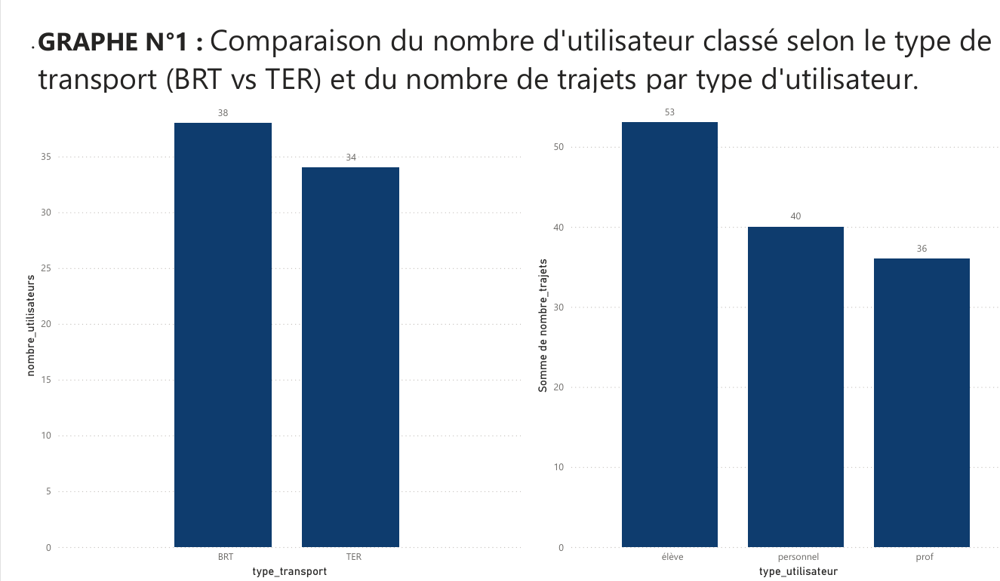
    > 
    
     Cela suggère une répartition équilibrée, **bien que le BRT soit légèrement plus populaire.** Cette information permet de cibler les ressources et les améliorations selon les préférences des utilisateurs.
    
2. **Les trajets les plus populaires (Graphe 2)**
    
    > Le tableau classe les 5 trajets les plus empruntés, avec la liaison **"Station BRT Guédiawaye - Station BRT Liberté 5" en tête avec 22 trajets**.
    > 
    > 
    > 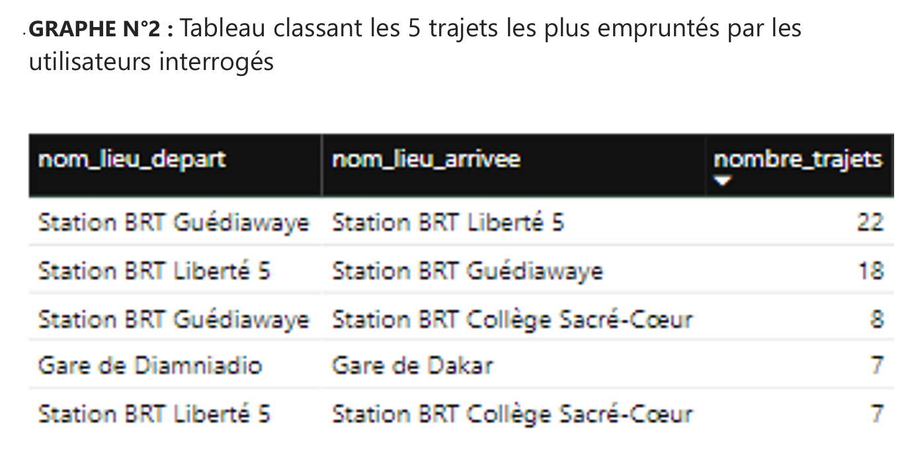
    > 
    
    Cette analyse des trajets les plus fréquentés est essentielle pour **optimiser la fréquence des services sur ces itinéraires**.
    
3. **Cartographie des stations et gares (Graphe 3)**
    
    > La carte interactive montre **la localisation des principales stations de transport à Dakar**.
    > 
    > 
    > 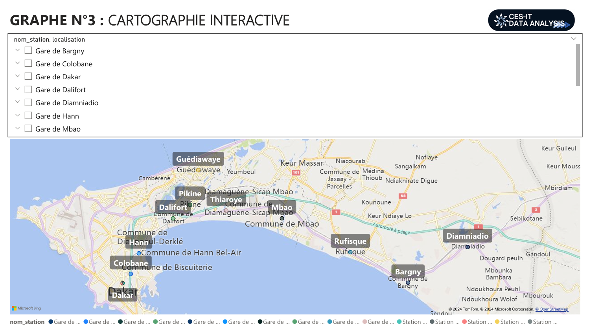
    > 
    > 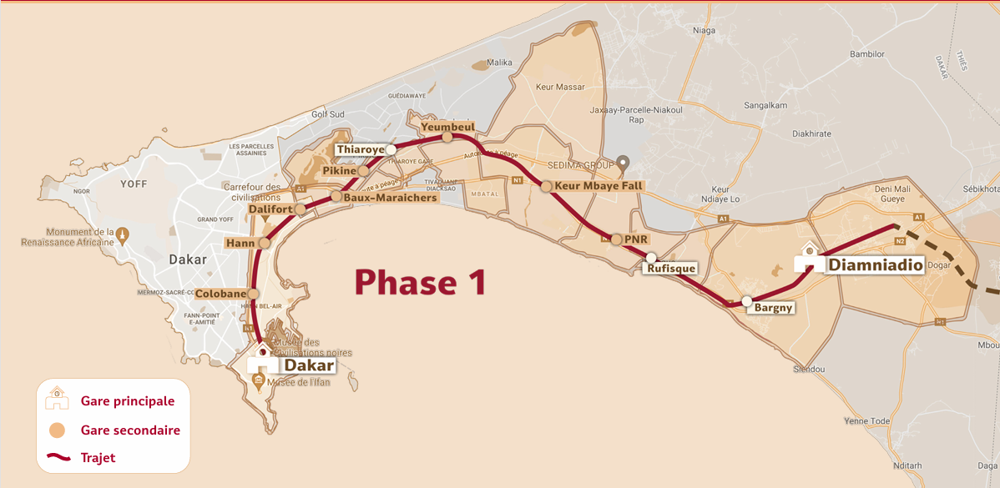
    > 
    
    Elle permet une **visualisation rapide des zones desservies**, facilitant **l’identification des zones potentiellement sous-desservies** ou nécessitant de nouvelles stations.
    
4. **Nombre de trajets par mois (Graphe 4)**
    
    > Ce graphique montre **la répartition mensuelle** des trajets effectués **en 2023 et 2024, avec des pics en janvier, mars, et octobre**.
    > 
    > 
    > 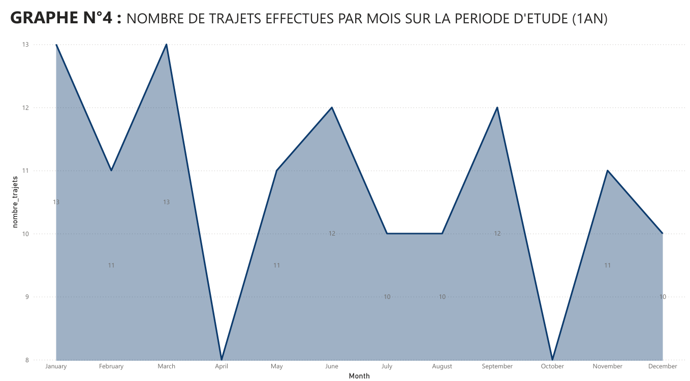
    > 
    
    Ces variations mensuelles indiquent une s**aisonnalité dans l’utilisation des transports**, utile pour **ajuster les services en fonction de la demande**.
    
5. **Utilisateurs les plus réguliers (Graphe 5)**
    
    > Le graphique identifie les **5 utilisateurs** ayant effectué le plus de trajets, tous ayant **entre 4 et 5 trajets**.
    > 
    > 
    > 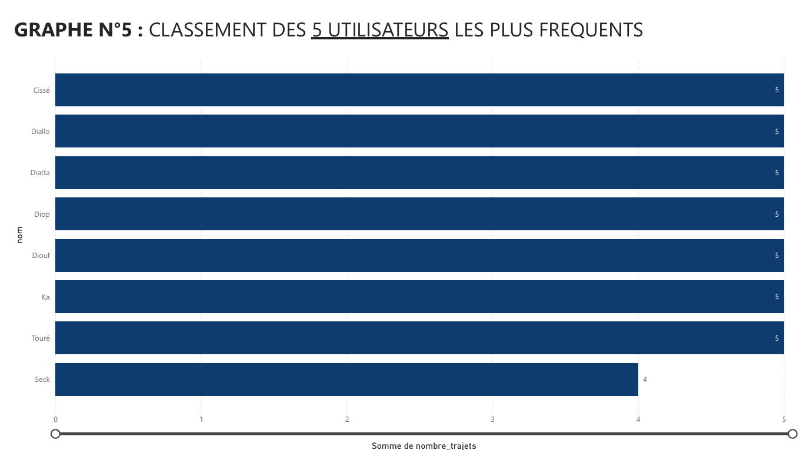
    > 
    
    Cette information permet de cibler des **programmes de fidélité** ou des **offres spéciales** pour les usagers réguliers.
    
6. **Taux d'utilisation par type d'utilisateur et transport (Graphe 6)**
    
    > Les élèves constituent le groupe d'utilisateurs le plus important (41%), suivi du personnel (31%) et des professeurs (28%).
    > 
    > 
    > 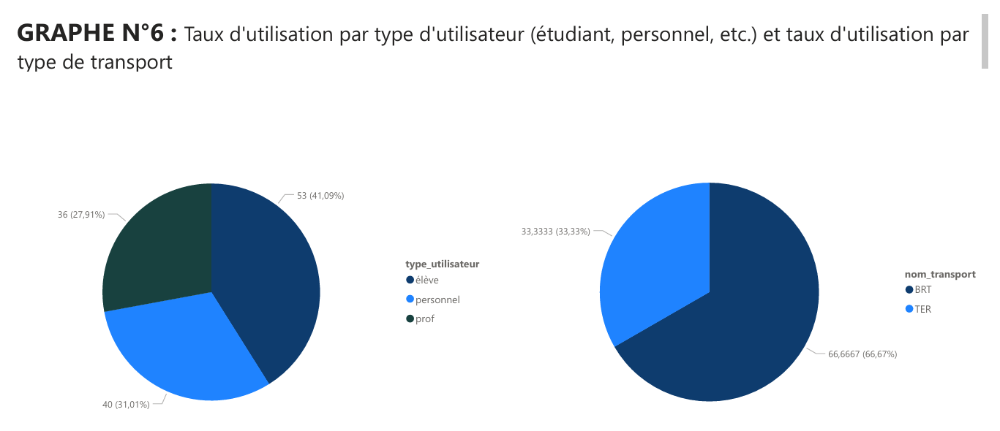
    > 
    
    Le **BRT est le transport le plus utilisé (66,67%)** par rapport au **TER (33,33%)**. 
    
    Cela montre une **tendance forte vers le BRT** et suggère de **renforcer les services** pour **répondre aux besoins des groupes majoritaires, comme les élèves**.
    
7. **Nombre de trajets par année (Graphe 7)**
    
    > Ce dernier graphique montre une augmentation de la fréquentation des transports en 2024 par rapport à 2023 (53,49% contre 46,51%).
    > 
    > 
    > 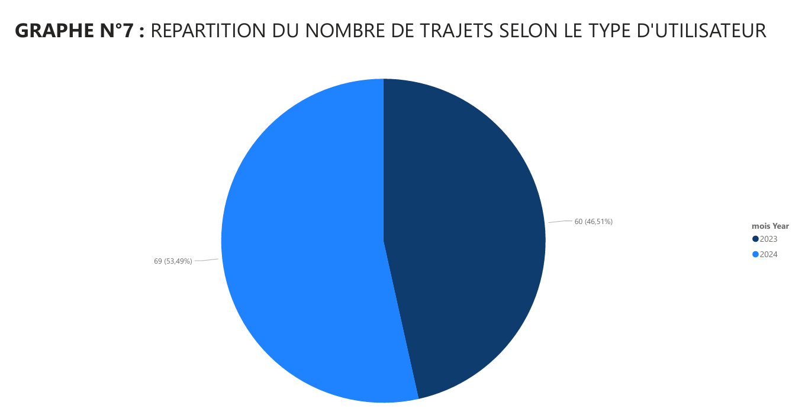
    > 
    
    Cette tendance à la hausse peut indiquer **une augmentation de la confiance des usagers** ou une **amélioration du service**, appelant à un **renforcement continu des infrastructures et des services.**
    

1. **Satisfaction moyenne par type de transport** 
    
    > Les données de satisfaction montrent que le niveau de satisfaction moyen pour le **TER** est de **7.6 /10**.  Celui  du BRT est de **7.5/10.**
    > 
    
    Cela révèle une légère avance pour **le TER** sur cet échantillon, traduisant tout de meme,  une nécessité d’amélioration et pourquoi pas, de mise en place ***‘d’enquetes utilisateurs’*** régulières afin de mettre en lumière les réels problèmes et ainsi s’en occuper au plus vite. Cette proposition permettra à terme de **cibler les efforts de service là où les utilisateurs expriment un besoin et de gérer les plaintes et problèmes remontés de manière prompte et efficace**.
    

<aside>

Ces informations permettent aux sociétés de transport et aux autorités de prendre des décisions éclairées pour améliorer l’offre de services, cibler les ressources efficacement et ajuster les infrastructures en fonction des habitudes et préférences des usagers.

</aside>

---

# **6. Conclusion et Propositions**

### **Propositions d’amélioration**

> Sur la base des données analysées, voici quelques **suggestions d’améliorations pour améliorer l’expérience des usagers et l’efficacité des services de transport :**
> 

1. **Développement d’une application mobile**
    
    Une application mobile dédiée pourrait offrir aux usagers une interface pratique pour consulter les horaires en temps réel, acheter leurs billets et donner leur feedback directement depuis leur téléphone. Voici quelques fonctionnalités clés pour maximiser l’adoption de l’application :
    
    - **Horaires en temps réel** : Afficher les horaires en direct pour chaque station, avec une mise à jour en fonction des retards ou incidents.
    - **Billetterie en ligne** : Permettre l’achat de billets électroniques directement via l’application, avec diverses options de paiement (cartes bancaires, portefeuilles électroniques, etc.).
    - **Feedback et réclamations** : Intégrer un formulaire de feedback pour recueillir les impressions des usagers, ainsi qu’une fonction de signalement pour des incidents ou dysfonctionnements constatés.
    - **Itinéraires personnalisés** : Fournir aux usagers des suggestions de trajets optimisés en fonction de leurs préférences et de l’affluence.
2. **Augmentation de la capacité des stations les plus fréquentées**
    
    Les données de fréquentation montrent que certaines stations du TER connaissent des embouteillages importants aux heures de pointe. Pour résoudre cette problématique :
    
    - **Aménagement des infrastructures** : Agrandir les quais et les halls d’attente dans les stations à forte affluence, en particulier celles desservant les pôles d’activité ou établissements scolaires.
    - **Ajout de signalisation** : Installer des panneaux de signalisation supplémentaires pour orienter les flux de passagers et réduire les engorgements.
    - **Renforcement du personnel d’accueil et de sécurité** : Augmenter le nombre d’agents présents dans ces stations pour assurer la fluidité des déplacements et répondre aux besoins des usagers en temps réel.
3. **Orienter l’analyse sur les tarifs par types de trajet**
    
    Analyser la tarification par type de trajet (courts, longs, périurbains) permettrait de mieux comprendre les préférences des usagers et d’optimiser la grille tarifaire. En adaptant les prix selon les spécificités de chaque segment :
    
    - **Étude de la rentabilité** : Analyser les coûts associés à chaque type de trajet pour ajuster les prix en fonction de la durée, du nombre de correspondances et de la demande.
    - **Propositions de réductions** : Proposer des tarifs préférentiels pour les trajets récurrents, notamment pour les travailleurs et étudiants, ou pour les groupes, afin de fidéliser une clientèle régulière.
    - **Création d’abonnements personnalisés** : Introduire des abonnements adaptés aux trajets les plus courants, comme les trajets domicile-travail ou domicile-école, permettant de réduire les coûts pour les usagers réguliers.

Ces propositions visent à améliorer l’accessibilité, la satisfaction et la fidélisation des usagers tout en optimisant l’efficacité opérationnelle des services de transport.

### Conclusion

Ce projet a permis **d'explorer les usages des transports publics par les utilisateurs de l'ISJA de Dakar, en focalisant l'analyse sur le TER et le BRT**, deux moyens de transport en pleine expansion dans la région.

En analysant ces données, nous avons pu **dégager des tendances d'utilisation, identifier des points d'amélioration potentiels pour optimiser la desserte des trajets, et fournir des perspectives** pour la planification future des infrastructures de transport. L’intégration de bases de données relationnelles, associée à des outils d’analyse comme Power BI, a contribué à une visualisation claire et exploitable des résultats, renforçant la compréhension des habitudes de déplacement.

Les informations obtenues sont précieuses pour les gestionnaires de transport, notamment en vue **d’optimiser les flux de voyageurs** et de **réduire les points de congestion**. 

**Ce travail constitue une base pour de futures analyses visant à approfondir la connaissance des comportements des usagers et à renforcer l’efficience des systèmes de transport à Dakar.**

---

### Outils Utilisés

Pour mener à bien ce projet, plusieurs outils ont été mobilisés :

- **MySQL Workbench et MySQL Commandline** : pour la gestion et la manipulation des données dans la base de données.
- **Power BI** : pour la création de visualisations et l’analyse des données.
- **Notion** : pour l’organisation, le suivi des tâches et l’élaboration du rapport.
- **GitHub** : pour le contrôle de version du code et la collaboration sur le projet.
- **Visual Studio Code (VSCode)** : pour l’édition du code et la création des scripts nécessaires à l’analyse.

### Webographie  / sources :

| Titre | Url | Date de consultation |
| --- | --- | --- |
| SQL HAVING - SQL | [https://sql.sh/cours/having#google_vignette](https://sql.sh/cours/having#google_vignette) | 23 septembre 2024 23:45 |
| Google Forms | [https://docs.google.com/forms/u/0/](https://docs.google.com/forms/u/0/) | 23 septembre 2024 23:46 |
| MySQL Constraints | [https://www.w3schools.com/mysql/mysql_constraints.asp](https://www.w3schools.com/mysql/mysql_constraints.asp) | 23 septembre 2024 23:46 |
| Train Express Régional - APIX-S.A. | [https://investinsenegal.sn/grand_travaux/train-express-regional/](https://investinsenegal.sn/grand_travaux/train-express-regional/) | 23 septembre 2024 23:48 |
| Coût, montage financier, tarifs, rotations, etc : tout sur le TER – Topnews | [https://www.topnews.sn/cout-montage-financier-tarifs-rotations-etc-tout-sur-le-ter/](https://www.topnews.sn/cout-montage-financier-tarifs-rotations-etc-tout-sur-le-ter/) | 23 septembre 2024 23:49 |
| Responsabilité numérique des entreprises : enjeux des données, environnementaux et sociaux | France Stratégie | [https://www.strategie.gouv.fr/infographies/responsabilite-numerique-entreprises-enjeux-donnees-environnementaux-sociaux](https://www.strategie.gouv.fr/infographies/responsabilite-numerique-entreprises-enjeux-donnees-environnementaux-sociaux) | 10 octobre 2024 16:01 |
| undefinedterdakar.sn | [https://www.terdakar.sn](https://www.terdakar.sn) | 2 novembre 2024 02:05 |
| Gamme tarifaire | [https://www.sunubrt.sn/titres-et-tarifs/quel-titre-choisir/](https://www.sunubrt.sn/titres-et-tarifs/quel-titre-choisir/) | 2 novembre 2024 02:06 |

---

### Crédits

> **Auteur du rapport technique** : Seyni Jr. Baldé, Ingénieur de données
> 
> 
> Responsable de la conception, de la recherche et de la maintenance de la base de données pour le projet **"SEN-TRANSPORT”.**
> 

---