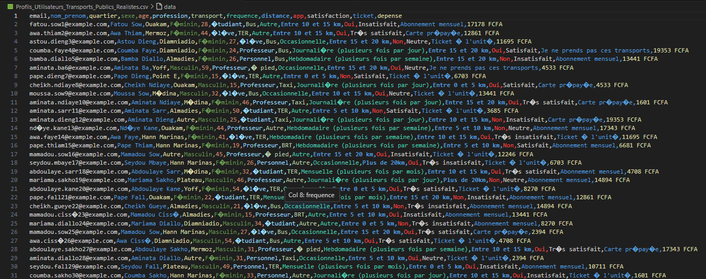
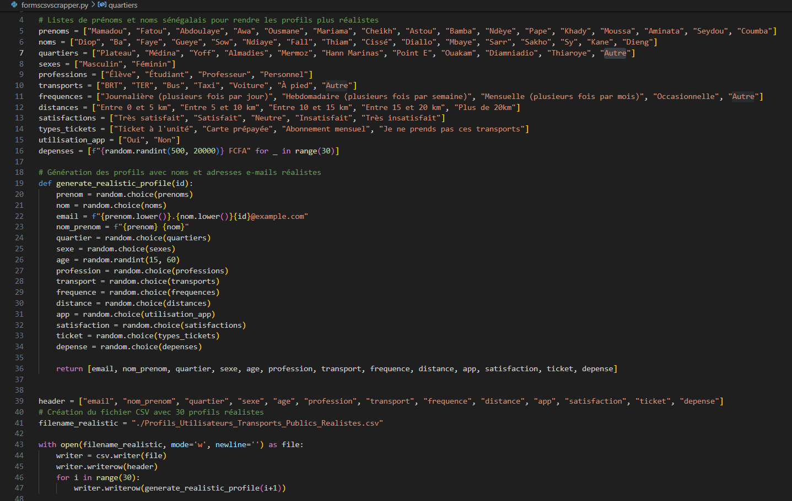
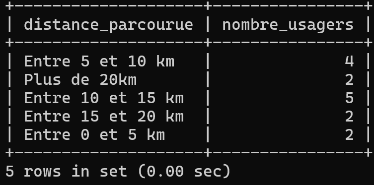

# Senegal transport
 
 > A university project throughout which we had to manage a public transport society's database to generate useful mass data-analysis inisghts and study users profile for strategic and marketing purposes

# **Projet 11 : "SEN-TRANSPORT", Analyse des Profils des Utilisateurs des Transports Publics à Dakar**

>### **Fiche Technique :** *Présentation de la base de données, de ses composantes puis analyse et interprétation des résultats obtenus*

**Auteurs**: 
- **Seyni Jr. Baldé**,  Data-Analyst chez *CESI-IT*
- **Jean Léandre Tiemtoré**, Data-Administrator chez *CESI-IT*
- **Sonia Hameg**, Data-Analyst chez *CESI-IT*

>Ce notebook présente et explique en détail les requêtes SQL utilisées pour analyser les données des utilisateurs des transports publics à Dakar, Sénégal, plus particulièrement du **TER et du BRT**. Le but est de rendre chaque requête compréhensible, même pour les non-initiés à SQL.

## **1. Création du Modèle Conceptuel de Données (MCD)**

>Le MCD (Modèle Conceptuel de Données) représente la structure logique des données et les relations entre les entités. Voici les principales entités et relations identifiées pour ce projet.

### Entités :
- **Utilisateur** : Informations générales sur les utilisateurs (élèves et personnel de l'ISJA).
- **Transport** : Type de transport utilisé par les usagers (TER, BRT, autre).
- **Station** : Les stations desservies par les transports.
- **Trajet** : Détails des trajets effectués par les utilisateurs.
- **Enquête** : Réponses des utilisateurs concernant leur satisfaction et leurs commentaires.
- **Utilisation** : Fréquence d'utilisation des différents moyens de transport.

### Relations :
- **Utilisateur - Transport** : Un utilisateur peut utiliser plusieurs types de transports.
- **Utilisateur - Trajet** : Un utilisateur peut faire plusieurs trajets.
- **Utilisateur - Enquête** : Un utilisateur peut répondre à une enquête.
- **Utilisateur - Utilisation** : Un utilisateur peut avoir plusieurs enregistrements d'utilisation de transport.

## **2. Conversion en Modèle Logique de Données (MLD)**

>Le MLD (Modèle Logique de Données) représente une forme plus structurée du MCD, prête à être implémentée dans une base de données relationnelle. Voici un aperçu des principales tables et de leurs colonnes :

### **Tables du MLD :**

**Utilisateur :**
- `id_utilisateur` (PRIMARY KEY)
- `nom` (VARCHAR)
- `prenom` (VARCHAR)
- `type_utilisateur` (ENUM('élève', 'personnel'))
- `email` (VARCHAR)

**Transport :**
- `id_transport` (PRIMARY KEY)
- `nom_transport` (ENUM('TER', 'BRT', 'Autre'))
- `type_transport` (VARCHAR)

**Station :**
- `id_station` (PRIMARY KEY)
- `nom_station` (VARCHAR)
- `localisation` (VARCHAR)

**Trajet :**
- `id_trajet` (PRIMARY KEY)
- `id_utilisateur` (FOREIGN KEY)
- `id_transport` (FOREIGN KEY)
- `id_station_depart` (FOREIGN KEY)
- `id_station_arrivee` (FOREIGN KEY)
- `date_trajet` (DATETIME)

**Enquête :**
- `id_enquete` (PRIMARY KEY)
- `id_utilisateur` (FOREIGN KEY)
- `satisfaction` (INT)
- `commentaires` (TEXT)
- `date_reponse` (DATE)

**Utilisation :**
- `id_utilisation` (PRIMARY KEY)
- `id_utilisateur` (FOREIGN KEY)
- `id_transport` (FOREIGN KEY)
- `frequence_utilisation` (ENUM('quotidienne', 'hebdomadaire', 'mensuelle'))

> (Il faudra ajouter les images des modèles graphiques de Sonia)

## **3. Implémentation du fichier CSV dans MySQL**

### **Étape 1 : Création des tables dans MySQL**

Voici les requêtes SQL pour créer les tables correspondant au MLD dans MySQL :

-- 1 Créer la table utilisateurs
CREATE TABLE IF NOT EXISTS Utilisateur (
    id_utilisateur INT AUTO_INCREMENT PRIMARY KEY,
    nom VARCHAR(50) NOT NULL,
    prenom VARCHAR(50) NOT NULL,
    type_utilisateur ENUM('élève', 'personnel') NOT NULL,
    email VARCHAR(100) NOT NULL UNIQUE
);

-- 2 Création de la table Transport
CREATE TABLE IF NOT EXISTS Transport (
    id_transport INT AUTO_INCREMENT PRIMARY KEY,
    nom_transport ENUM('TER', 'BRT', 'Autre') NOT NULL,
    type_transport VARCHAR(50) NOT NULL
);

-- 3 Création de la table Station
CREATE TABLE IF NOT EXISTS Station (
    id_station INT AUTO_INCREMENT PRIMARY KEY,
    nom_station VARCHAR(100) NOT NULL,
    localisation VARCHAR(100) NOT NULL
);

-- 4 Création de la table Trajet
CREATE TABLE IF NOT EXISTS Trajet (
    id_trajet INT AUTO_INCREMENT PRIMARY KEY,
    id_utilisateur INT NOT NULL,
    id_transport INT NOT NULL,
    id_station_depart INT NOT NULL,
    id_station_arrivee INT NOT NULL,
    date_trajet DATETIME NOT NULL,
    FOREIGN KEY (id_utilisateur) REFERENCES Utilisateur(id_utilisateur),
    FOREIGN KEY (id_transport) REFERENCES Transport(id_transport),
    FOREIGN KEY (id_station_depart) REFERENCES Station(id_station),
    FOREIGN KEY (id_station_arrivee) REFERENCES Station(id_station)
);

-- 5 Création de la Table Enquete
CREATE TABLE IF NOT EXISTS Enquete (
    id_enquete INT AUTO_INCREMENT PRIMARY KEY,
    id_utilisateur INT NOT NULL,
    satisfaction INT NOT NULL,
    commentaires TEXT,
    date_reponse DATE NOT NULL,
    FOREIGN KEY (id_utilisateur) REFERENCES Utilisateur(id_utilisateur)
);

-- 6 Création de la table Utilisation
CREATE TABLE IF NOT EXISTS Utilisation (
    id_utilisation INT AUTO_INCREMENT PRIMARY KEY,
    id_utilisateur INT NOT NULL,
    id_transport INT NOT NULL,
    frequence_utilisation ENUM('quotidienne', 'hebdomadaire', 'mensuelle') NOT NULL,
    FOREIGN KEY (id_utilisateur) REFERENCES Utilisateur(id_utilisateur),
    FOREIGN KEY (id_transport) REFERENCES Transport(id_transport)
);
### **Étape 2 : Importation du fichier CSV dans la table Utilisateur (Méthode MySQLW.bench + Méthode SQL cmdline)**

Pour importer un fichier CSV (`Profils_Utilisateurs_Transports_Publics_Realistes.csv`) dans la table Utilisateur, suis ces étapes :

1. Utilise la fonction **Table Data Import Wizard** dans MySQL Workbench.
2. Sélectionne le fichier CSV à importer.
3. Assure-toi que les colonnes du fichier CSV sont correctement mappées aux colonnes de la table.
4. Lance l'importation.

>On peux aussi importer les données directement en utilisant la commande `LOAD DATA INFILE` si l'on accède à la ligne de commande MySQL (*SQL CMD Line*).

### **Explications :**
>Chaque commande **"LOAD DATA INFILE"** charge les colonnes correspondantes à chaque table et ignore les autres colonnes en utilisant **@dummy**.
***Vous devez exécuter une commande distincte pour chaque table.***
Ces commandes vont importer les données du fichier CSV dans les différentes tables créées.

>### **BDD Fictive créée grace à un programme de scrapping python :**

>### **Programme de scrapping python avec l'aides de la librairie *"csv"* et du module *"random"* :**

> ### **Script SQL pour l'importation des données de notre table fictive selon les attributs de cette dernière et des tables préalablement créées:**
-- 1. Importation des utilisateurs dans la table Utilisateur
LOAD DATA INFILE './Profils_Utilisateurs_Transports_Publics_Realistes.csv'
INTO TABLE Utilisateur
FIELDS TERMINATED BY ',' 
ENCLOSED BY '"' 
LINES TERMINATED BY '\n'
IGNORE 1 LINES
(email, nom_prenom, quartier, sexe, age, profession, @dummy, @dummy, @dummy, @dummy, @dummy, @dummy, @dummy);

-- 2. Importation des moyens de transport dans la table Transport
LOAD DATA INFILE './Profils_Utilisateurs_Transports_Publics_Realistes.csv'
INTO TABLE Transport
FIELDS TERMINATED BY ',' 
ENCLOSED BY '"' 
LINES TERMINATED BY '\n'
IGNORE 1 LINES
(@dummy, @dummy, @dummy, @dummy, @dummy, @dummy, moyen_transport, @dummy, @dummy, @dummy, @dummy, @dummy, @dummy);

-- Récupération des ID utilisateurs
SELECT id_utilisateur, email FROM Utilisateur;

-- Récupération des ID transports
SELECT id_transport, moyen_transport FROM Transport;

-- 8. Importation des données dans la table Trajet
LOAD DATA INFILE './Profils_Utilisateurs_Transports_Publics_Realistes.csv'
INTO TABLE Trajet
FIELDS TERMINATED BY ',' 
ENCLOSED BY '"' 
LINES TERMINATED BY '\n'
IGNORE 1 LINES
(@dummy, @dummy, @dummy, @dummy, @dummy, @dummy, @dummy, frequence_utilisation, distance_parcourue, @dummy, satisfaction, @dummy, @dummy);

-- 9. Importation des données dans la table Tickets
LOAD DATA INFILE './Profils_Utilisateurs_Transports_Publics_Realistes.csv'
INTO TABLE Tickets
FIELDS TERMINATED BY ',' 
ENCLOSED BY '"' 
LINES TERMINATED BY '\n'
IGNORE 1 LINES
(@dummy, @dummy, @dummy, @dummy, @dummy, @dummy, @dummy, @dummy, @dummy, @dummy, @dummy, type_ticket, depenses_mensuelles);

-- 10. Importation des données dans la table Application_Mobile
LOAD DATA INFILE './Profils_Utilisateurs_Transports_Publics_Realistes.csv'
INTO TABLE Application_Mobile
FIELDS TERMINATED BY ',' 
ENCLOSED BY '"' 
LINES TERMINATED BY '\n'
IGNORE 1 LINES
(@dummy, @dummy, @dummy, @dummy, @dummy, @dummy, @dummy, @dummy, @dummy, app_utilisation, @dummy, @dummy, @dummy);

## **1. Liste des utilisateurs**

>Cette requête permet d'extraire les informations de base des utilisateurs (nom, sexe, âge, quartier, profession). Elle est utile pour avoir une vue d'ensemble des utilisateurs enregistrés dans la base de données.

### **Explication :**
- **nom_prenom :** Le nom complet de l'utilisateur.
- **sexe :** Le genre de l'utilisateur (masculin ou féminin).
- **age :** L'âge de l'utilisateur.
- **quartier :** Le quartier où réside l'utilisateur.
- **profession :** La profession actuelle de l'utilisateur.

SELECT nom_prenom, sexe, age, quartier, profession 
FROM Utilisateur;
> **L'affichage obtenu est le suivant :** 

## **2. Profil des utilisateurs par quartier** 

>Cette requête permet de compter le nombre d'utilisateurs par quartier. 
Elle est utile pour comprendre ***la répartition géographique des usagers*** et ***identifier les quartiers les plus représentés***.

### **Explication :**
- **COUNT():** Cette fonction permet de compter le nombre d'utilisateurs par quartier.
- **GROUP BY :** Cette clause permet de regrouper les utilisateurs par quartier, afin d'obtenir une liste des quartiers avec le nombre d'utilisateurs respectifs.

SELECT quartier, COUNT(*) AS nombre_utilisateurs
FROM Utilisateur
GROUP BY quartier;

> **L'affichage obtenu est le suivant :** 

## **3. Moyens de transport utilisés**

>Cette requête analyse les moyens de transport utilisés par les usagers. Elle permet aux gestionnaires de voir **quel type de transport est le plus populaire**.

### Explication :

- **moyen_transport :** Le type de transport utilisé (BRT, TER, etc.).
- **JOIN :** Cette commande permet de combiner deux tables (Transport et Trajet) afin d'obtenir des informations sur les trajets effectués.
- **GROUP BY :** Regroupe les résultats par type de transport.
/*3. Moyens de transport utilisés*/
SELECT moyen_transport, COUNT(*) AS nombre_utilisateurs
FROM Transport
JOIN Trajet ON Transport.id_transport = Trajet.id_transport
GROUP BY moyen_transport;

## (défaillant)**4. Satisfaction des utilisateurs par transport**

>Cette requête permet de mesurer la satisfaction des utilisateurs en fonction du moyen de transport qu'ils utilisent. Elle aide à identifier si un certain type de transport satisfait mieux les usagers.

### Explications :
- **satisfaction :** Indique le niveau de satisfaction des utilisateurs (Très satisfait, Satisfait, etc.).
- **GROUP BY :** Regroupe les données par moyen de transport et par niveau de satisfaction.
/*4. Satisfaction des utilisateurs par transport*/
SELECT Transport.moyen_transport, Trajet.satisfaction, COUNT(*) AS nombre_usagers
FROM Trajet
JOIN Transport ON Trajet.id_transport = Transport.id_transport
GROUP BY Transport.moyen_transport, Trajet.satisfaction;

## **5. Dépenses moyennes par type de ticket**

>Cette requête permet d'obtenir la dépense mensuelle moyenne des usagers en fonction du type de ticket qu'ils utilisent. Cela peut aider les sociétés de transport à comprendre les habitudes de dépenses des utilisateurs.

### **Explication :**
- **AVG() :** Cette fonction calcule la moyenne des dépenses mensuelles.
- **REPLACE() :** Enlève la mention "FCFA" dans les dépenses pour pouvoir faire un calcul.
- **CAST() :** Convertit les valeurs en nombre pour effectuer des opérations mathématiques.

/* 5. Dépenses moyennes par type de ticket */
SELECT type_ticket, AVG(CAST(REPLACE(depenses_mensuelles, ' FCFA', '') AS DECIMAL)) AS depense_moyenne
FROM Tickets
GROUP BY type_ticket;

> **L'affichage obtenu est le suivant :** 

## **6. Utilisation des applications mobiles**

>Cette requête permet de connaître le nombre d'utilisateurs qui utilisent une application mobile pour consulter les horaires ou acheter des billets.

### Explication :
- **app_utilisation :** Indique si l'utilisateur a utilisé une application mobile (Oui ou Non).
- **COUNT() :** Compte combien d'utilisateurs ont utilisé une application mobile.
- **GROUP BY :** Regroupe les résultats par utilisation d'application.
/*6. Utilisation des applications mobiles*/
SELECT app_utilisation, COUNT(*) AS nombre_utilisateurs
FROM Application_Mobile
GROUP BY app_utilisation;

> L'affichage de cette requete est le suivant :

## **(défaillant) 7. Utilisateurs fréquents (journaliers)**
>Cette requête permet d'identifier les utilisateurs qui utilisent les transports en commun de manière journalière. Ces informations peuvent être utiles pour des programmes de fidélisation.

### **Explication :**
- **WHERE :** Filtre les utilisateurs qui utilisent les transports journalièrement.
- **JOIN :** Permet de lier les données des utilisateurs avec leurs trajets.
/* 7. Utilisateurs fréquents (journaliers) */
SELECT nom_prenom, profession, quartier, satisfaction
FROM Utilisateur u
JOIN Trajet t ON u.id_utilisateur = t.id_utilisateur
WHERE t.frequence_utilisation = 'Journalière (plusieurs fois par jour)';

## **8. Analyse des distances parcourues par les usagers satisfaits**

>Cette requête permet d'analyser les distances parcourues par les usagers qui se disent satisfaits de leur expérience de transport. Elle peut aider à ajuster la logistique et l'offre de transport.

### Explication :
**WHERE :** Filtre pour ne garder que les utilisateurs satisfaits ou très satisfaits.
**GROUP BY :** Regroupe les résultats par distance parcourue.
/* 8. Analyse des distances parcourues par les usagers satisfaits */
SELECT distance_parcourue, COUNT(*) AS nombre_usagers
FROM Trajet
WHERE satisfaction IN ('Très satisfait', 'Satisfait')
GROUP BY distance_parcourue;

> L'affichage de cette requete est le suivant :

