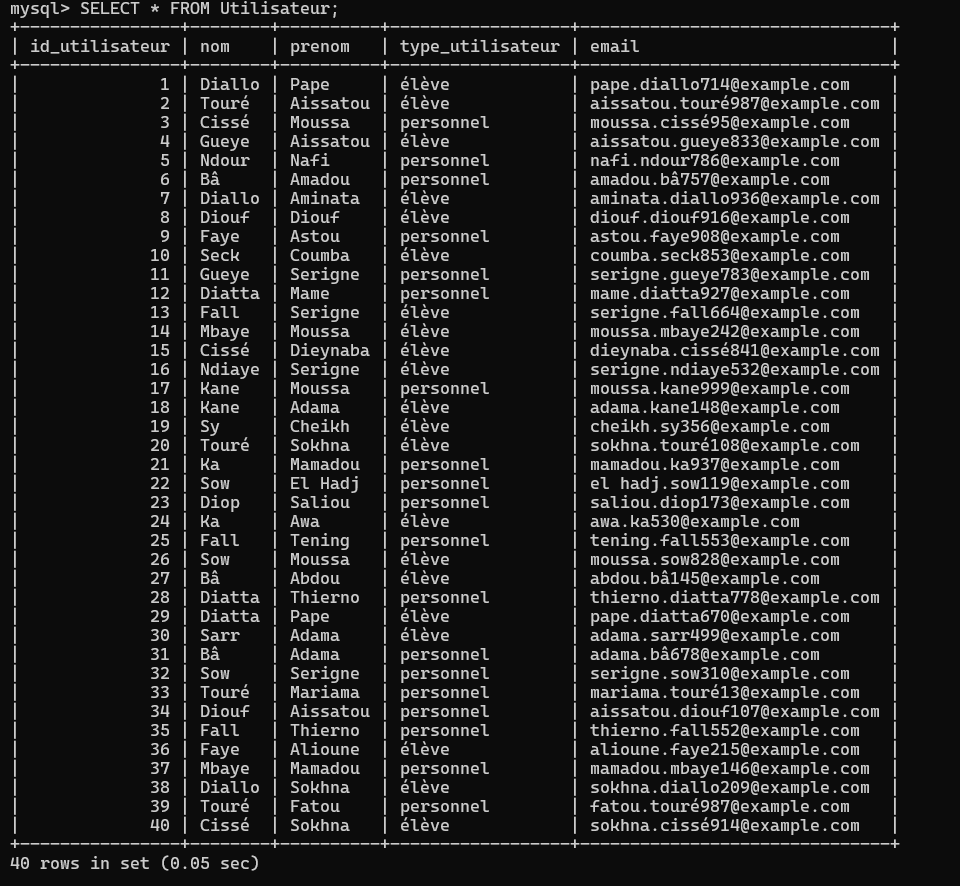
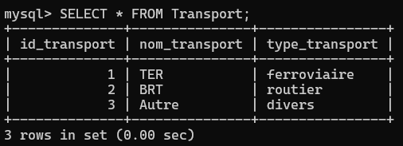
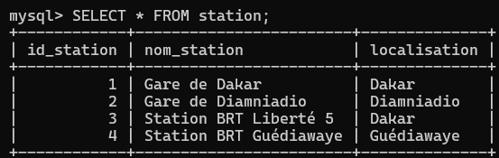
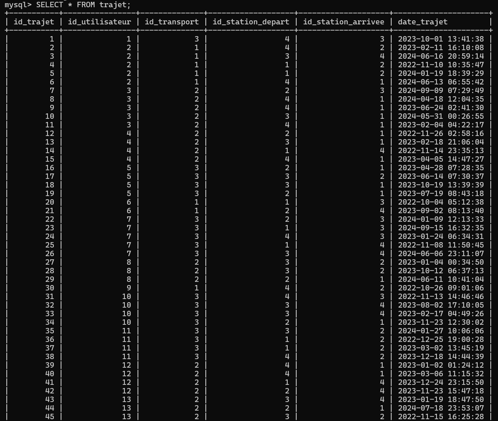
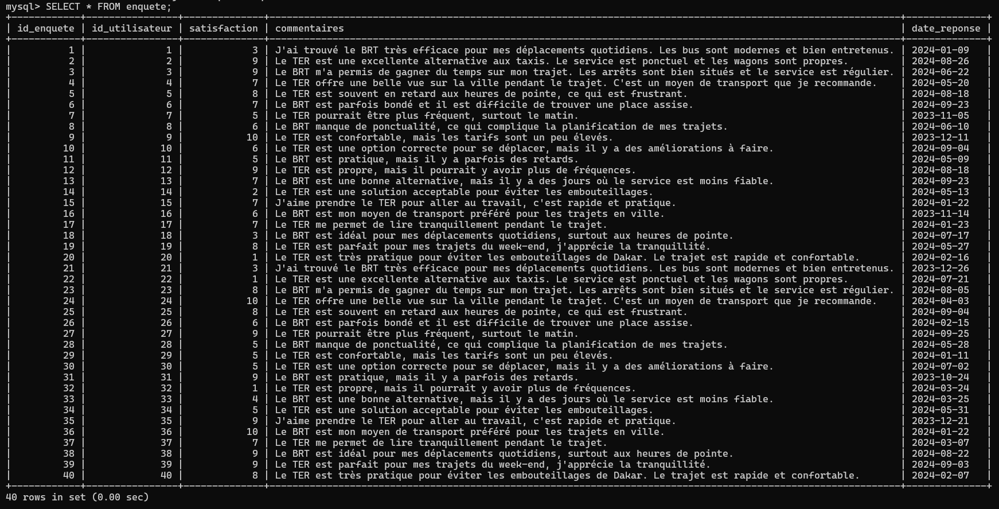

# **Projet 11 : "SEN-TRANSPORT", Analyse des Profils des Utilisateurs des Transports Publics à Dakar**


>### **Fiche Technique :** *Présentation de la base de données, de ses composantes puis analyse et interprétation des résultats obtenus*

---

## **Introduction**

### Sommaire

1. [Les Auteurs](#les-auteurs)
2. [Objectifs](#1.1-Objectifs)
3. [Modélisation des Données](#Modélisation-des-données)
   - [Modèle Conceptuel de Données (MCD)](#modèle-conceptuel-de-données-mcd)
   - [Modèle Logique de Données (MLD)](#modèle-logique-de-données-mld)
4. [Résultats et Interprétation](#résultats-et-interprétation)
5. [Propositions d'Innovations](#propositions-dinnovations)
6. [Conclusion](#conclusion)

### **Les Auteurs**: 
- **Seyni Jr. Baldé**,  Data-Analyst et manager de projet chez *CES-IT*
- **Jean Léandre Tiemtoré**, Administrateur de Bases de Données chez *CES-IT*
- **Sonia Hameg**, Ingénieur de Conception et Modélisation Data chez *CES-IT*


> Ce notebook, faisant état de **fiche technique**, présente et explique en détail le processus que notre équipe a utilisée pour analyser les données des utilisateurs des transports publics à Dakar, Sénégal, plus particulièrement du **TER et du BRT**. 
Au delà de **rendre compte de notre travail de recherche et d'enquete**, l'objectif final est de fournir **une explication concise et compréhensible**, même pour les non-initiés à l'informatique technique.

### **1.1. Objectifs**
- **Profilage des utilisateurs** : catégorisation des usagers (élèves, personnel, etc.).
- **Analyse des trajets** : étude des trajets réalisés et des fréquences d'utilisation.
- **Mesure de la satisfaction** : évaluation des retours d'expérience des utilisateurs.
- **Propositions d'innovations** : suggestions d'améliorations basées sur les données récoltées.


---

## **2. Modélisation des Données**

### **2.1. Modèle Conceptuel de Données (MCD)**

>Le MCD permet de **définir les entités et les relations entre elles**. 
Voici les principales entités de notre étude projet :

- **Utilisateur** : Représente les informations des usagers (élèves, personnel).
- **Transport** : Type de transport utilisé (TER, BRT, autre).
- **Station** : Stations desservies par les moyens de transport.
- **Trajet** : Trajets réalisés par les utilisateurs.
- **Enquête** : Réponses aux enquêtes sur la satisfaction des usagers.


### **2.2. Modèle Logique de Données (MLD)**

> Le MLD est la traduction technique du MCD, structuré sous forme de tables relationnelles dans la base de données MySQL. Voici les tables créées et leurs colonnes respectives :

#### **Utilisateur**
- `id_utilisateur` (PRIMARY KEY)
- `nom` (VARCHAR)
- `prenom` (VARCHAR)
- `type_utilisateur` (ENUM('élève', 'personnel'))
- `email` (VARCHAR UNIQUE)

#### **Transport**
- `id_transport` (PRIMARY KEY)
- `nom_transport` (ENUM('TER', 'BRT', 'Autre'))
- `type_transport` (VARCHAR)

#### **Station**
- `id_station` (PRIMARY KEY)
- `nom_station` (VARCHAR)
- `localisation` (VARCHAR)

#### **Trajet**
- `id_trajet` (PRIMARY KEY)
- `id_utilisateur` (FOREIGN KEY)
- `id_transport` (FOREIGN KEY)
- `id_station_depart` (FOREIGN KEY)
- `id_station_arrivee` (FOREIGN KEY)
- `date_trajet` (DATETIME)

#### **Enquête**
- `id_enquete` (PRIMARY KEY)
- `id_utilisateur` (FOREIGN KEY)
- `satisfaction` (INT)
- `commentaires` (TEXT)
- `date_reponse` (DATE)


---

## **3. Mise en Œuvre Technique**


### **3.1. Connexion à la Base de Données MySQL avec Python**

> Le code Python suivant permet de **se connecter à la base de données MySQL et d'insérer des données factices :**

```python
from PASSWORD import password 
# J'importe un ficier python externe qui contient une variable 'password' contenant mon mot de passe.
# => Permet de ne pas dévoiler ce dernier au public lors du partage du code source.

#Importation des modules nécessaires pour la création des tables :
import mysql.connector # pour implémenter du code MySQL directement dans python
from random import choice, randint 
from faker import Faker 

# **Initialiser Faker pour générer des données textuelles factices en français**
fake = Faker('fr_FR')

# Listes élargies de prénoms et noms sénégalais
prenoms_hommes = [
    'Moustapha', 'Cheikh', 'Oumar', 'Serigne', 'Mamadou', 'Modou', 'Abdou', 'Ibrahima', 'Babacar', 'Moussa',
    'Alioune', 'Pape', 'Amadou', 'Issa', 'Diouf', 'Saliou', 'El Hadj', 'Thierno', 'Mouhamadou'
]
prenoms_femmes = [
    'Aminata', 'Fatou', 'Mame', 'Mariama', 'Adama', 'Ndèye', 'Sokhna', 'Awa', 'Coumba', 'Khadija',
    'Diarra', 'Bineta', 'Yacine', 'Astou', 'Nafi', 'Dieynaba', 'Aissatou', 'Fatimata', 'Tening'
]
noms_famille = [
    'Ndiaye', 'Diop', 'Faye', 'Sow', 'Bâ', 'Gueye', 'Sy', 'Sarr', 'Diallo', 'Kane', 'Fall', 'Diouf',
    'Camara', 'Touré', 'Dieng', 'Diatta', 'Ndour', 'Ka', 'Cissé', 'Lo', 'Mbaye', 'Seck'
]

# Connexion à la base de données MySQL
db = mysql.connector.connect(
    host="localhost",
    user="root",       # Remplacer par votre utilisateur MySQL
    password= password,  # Le mot de passe d'accès à ma base de données
    database="isja_transport"       # Nom de la base de données
)

cursor = db.cursor()

# Création de la base de données si elle n'existe pas
cursor.execute("CREATE DATABASE IF NOT EXISTS isja_transport;")
cursor.execute("USE isja_transport;")

# Création des tables

# Table Utilisateur (anciennement Personne)
cursor.execute('''
    CREATE TABLE IF NOT EXISTS Utilisateur (
        id_utilisateur INT AUTO_INCREMENT PRIMARY KEY,
        nom VARCHAR(50) NOT NULL,
        prenom VARCHAR(50) NOT NULL,
        type_utilisateur ENUM('élève', 'personnel') NOT NULL,
        email VARCHAR(100) NOT NULL UNIQUE
    );
''')

# Table Transport
cursor.execute('''
    CREATE TABLE IF NOT EXISTS Transport (
        id_transport INT AUTO_INCREMENT PRIMARY KEY,
        nom_transport ENUM('TER', 'BRT', 'Autre') NOT NULL,
        type_transport VARCHAR(50) NOT NULL
    );
''')

# Table Station
cursor.execute('''
    CREATE TABLE IF NOT EXISTS Station (
        id_station INT AUTO_INCREMENT PRIMARY KEY,
        nom_station VARCHAR(100) NOT NULL,
        localisation VARCHAR(100) NOT NULL
    );
''')

# Table Trajet
cursor.execute('''
    CREATE TABLE IF NOT EXISTS Trajet (
        id_trajet INT AUTO_INCREMENT PRIMARY KEY,
        id_utilisateur INT NOT NULL,
        id_transport INT NOT NULL,
        id_station_depart INT NOT NULL,
        id_station_arrivee INT NOT NULL,
        date_trajet DATETIME NOT NULL,
        FOREIGN KEY (id_utilisateur) REFERENCES Utilisateur(id_utilisateur),
        FOREIGN KEY (id_transport) REFERENCES Transport(id_transport),
        FOREIGN KEY (id_station_depart) REFERENCES Station(id_station),
        FOREIGN KEY (id_station_arrivee) REFERENCES Station(id_station)
    );
''')

# Table Enquete
cursor.execute('''
    CREATE TABLE IF NOT EXISTS Enquete (
        id_enquete INT AUTO_INCREMENT PRIMARY KEY,
        id_utilisateur INT NOT NULL,
        satisfaction INT NOT NULL,
        commentaires TEXT,
        date_reponse DATE NOT NULL,
        FOREIGN KEY (id_utilisateur) REFERENCES Utilisateur(id_utilisateur)
    );
''')

# Table Utilisation
cursor.execute('''
    CREATE TABLE IF NOT EXISTS Utilisation (
        id_utilisation INT AUTO_INCREMENT PRIMARY KEY,
        id_utilisateur INT NOT NULL,
        id_transport INT NOT NULL,
        frequence_utilisation ENUM('quotidienne', 'hebdomadaire', 'mensuelle') NOT NULL,
        FOREIGN KEY (id_utilisateur) REFERENCES Utilisateur(id_utilisateur),
        FOREIGN KEY (id_transport) REFERENCES Transport(id_transport)
    );
''')

db.commit()

# Insérer des données factices

def inserer_donnees_factices(nb_utilisateurs=40):  # Augmentation à 40 utilisateurs
    # Insérer les transports
    transports = [
        ('TER', 'ferroviaire'),
        ('BRT', 'routier'),
        ('Autre', 'divers')
    ]
    cursor.executemany('''
        INSERT INTO Transport (nom_transport, type_transport)
        VALUES (%s, %s)
    ''', transports)
    db.commit()

    # Récupérer les IDs des transports
    cursor.execute('SELECT id_transport FROM Transport')
    transports_ids = [row[0] for row in cursor.fetchall()]

    # Insérer les stations
    stations = [
        ('Gare de Dakar', 'Dakar'),
        ('Gare de Diamniadio', 'Diamniadio'),
        ('Station BRT Liberté 5', 'Dakar'),
        ('Station BRT Guédiawaye', 'Guédiawaye'),
        ('Taxi', 'routier'),
        ('Bus DemDikk', 'routier')
        # Ajouter d'autres stations si nécessaire
    ]
    cursor.executemany('''
        INSERT INTO Station (nom_station, localisation)
        VALUES (%s, %s)
    ''', stations)
    db.commit()

    # Récupérer les IDs des stations
    cursor.execute('SELECT id_station FROM Station')
    stations_ids = [row[0] for row in cursor.fetchall()]

    fréquences = ['quotidienne', 'hebdomadaire', 'mensuelle']
    utilisateurs_existe = set()

    while len(utilisateurs_existe) < nb_utilisateurs:
        nom = choice(noms_famille)
        prenom = choice(prenoms_hommes + prenoms_femmes)

        # Créer un email unique
        email = f"{prenom.lower()}.{nom.lower()}{randint(1, 999)}@example.com"

        # Vérifier si l'utilisateur existe déjà (nom, prénom)
        utilisateur_unique = (prenom, nom)
        if utilisateur_unique in utilisateurs_existe:
            continue  # Si l'utilisateur existe déjà, on passe à la suivante
        utilisateurs_existe.add(utilisateur_unique)

        type_utilisateur = choice(['élève', 'personnel'])

        # Insérer l'utilisateur
        cursor.execute('''
            INSERT INTO Utilisateur (nom, prenom, type_utilisateur, email)
            VALUES (%s, %s, %s, %s)
        ''', (nom, prenom, type_utilisateur, email))
        db.commit()

        id_utilisateur = cursor.lastrowid

        # Choisir un transport aléatoirement
        id_transport = choice(transports_ids)
        frequence_utilisation = choice(fréquences)

        # Insérer dans Utilisation
        cursor.execute('''
            INSERT INTO Utilisation (id_utilisateur, id_transport, frequence_utilisation)
            VALUES (%s, %s, %s)
        ''', (id_utilisateur, id_transport, frequence_utilisation))
        db.commit()

        # Insérer une réponse à l'enquête
        satisfaction = randint(1, 10)
        commentaires = f"J'ai apprécié mon trajet en {choice(['TER', 'BRT'])}."  # Commentaire plus cohérent
        date_reponse = fake.date_between(start_date='-1y', end_date='today')

        cursor.execute('''
            INSERT INTO Enquete (id_utilisateur, satisfaction, commentaires, date_reponse)
            VALUES (%s, %s, %s, %s)
        ''', (id_utilisateur, satisfaction, commentaires, date_reponse))
        db.commit()

        # Générer des trajets
        for _ in range(randint(1, 5)):
            id_station_depart = choice(stations_ids)
            id_station_arrivee = choice(stations_ids)
            while id_station_arrivee == id_station_depart:
                id_station_arrivee = choice(stations_ids)
            date_trajet = fake.date_time_between(start_date='-2y', end_date='now')

            cursor.execute('''
                INSERT INTO Trajet (id_utilisateur, id_transport, id_station_depart, id_station_arrivee, date_trajet)
                VALUES (%s, %s, %s, %s, %s)
            ''', (id_utilisateur, id_transport, id_station_depart, id_station_arrivee, date_trajet))
            db.commit()

inserer_donnees_factices()

print("Les données locales ont été insérées avec succès !")
```

### **3.2. Création des Tables dans MySQL**

Voici les commandes SQL pour la création des tables :

``` sql
CREATE TABLE IF NOT EXISTS Utilisateur (
    id_utilisateur INT AUTO_INCREMENT PRIMARY KEY,
    nom VARCHAR(50) NOT NULL,
    prenom VARCHAR(50) NOT NULL,
    type_utilisateur VARCHAR(100) NOT NULL,
    email VARCHAR(100) NOT NULL UNIQUE
);
```
>###  **Affichage de la table :**

```sql
CREATE TABLE IF NOT EXISTS Transport (
    id_transport INT AUTO_INCREMENT PRIMARY KEY,
    nom_transport VARCHAR(100) NOT NULL,
    type_transport VARCHAR(50) NOT NULL
);
```

>###  **Affichage de la table :**


```sql
CREATE TABLE IF NOT EXISTS Station (
    id_station INT AUTO_INCREMENT PRIMARY KEY,
    nom_station VARCHAR(100) NOT NULL,
    localisation VARCHAR(100) NOT NULL
);
```
>###  **Affichage de la table :**


```sql
CREATE TABLE IF NOT EXISTS Trajet (
    id_trajet INT AUTO_INCREMENT PRIMARY KEY,
    id_utilisateur INT NOT NULL,
    id_transport INT NOT NULL,
    id_station_depart INT NOT NULL,
    id_station_arrivee INT NOT NULL,
    date_trajet DATETIME NOT NULL,
    FOREIGN KEY (id_utilisateur) REFERENCES Utilisateur(id_utilisateur),
    FOREIGN KEY (id_transport) REFERENCES Transport(id_transport),
    FOREIGN KEY (id_station_depart) REFERENCES Station(id_station),
    FOREIGN KEY (id_station_arrivee) REFERENCES Station(id_station)
);
```
>###  **Affichage de la table :**


```sql
CREATE TABLE IF NOT EXISTS Enquete (
    id_enquete INT AUTO_INCREMENT PRIMARY KEY,
    id_utilisateur INT NOT NULL,
    satisfaction INT NOT NULL,
    commentaires TEXT,
    date_reponse DATE NOT NULL,
    FOREIGN KEY (id_utilisateur) REFERENCES Utilisateur(id_utilisateur)
);
```
>###  **Affichage de la table :**



---

## **4. Analyse et Interprétation des Données**

### **4.1. Requêtes SQL pour l'Analyse des Données**

> Voici une série de **requêtes SQL qui vont nous permettre d'analyser les données de la base et d'en extraire des informations utiles pour l'entreprise :

### **Nombre total d'utilisateurs par type (élève ou personnel)** :
```sql
SELECT type_utilisateur, COUNT(*) AS nombre_utilisateurs
FROM Utilisateur
GROUP BY type_utilisateur;
```
### **Nombre total de trajets effectués par chaque utilisateur** :
```sql
SELECT Utilisateur.nom, Utilisateur.prenom, COUNT(Trajet.id_trajet) AS nombre_trajets
FROM Utilisateur
LEFT JOIN Trajet ON Utilisateur.id_utilisateur = Trajet.id_utilisateur
GROUP BY Utilisateur.id_utilisateur;
```

### **Répartition des transports utilisés** :
```sql
SELECT Transport.nom_transport, COUNT(Trajet.id_trajet) AS nombre_trajets
FROM Trajet
JOIN Transport ON Trajet.id_transport = Transport.id_transport
GROUP BY Transport.nom_transport;
```
### **Top 5 des utilisateurs les plus actifs** :
```sql
SELECT Utilisateur.nom, Utilisateur.prenom, COUNT(Trajet.id_trajet) AS nombre_trajets
FROM Utilisateur
JOIN Trajet ON Utilisateur.id_utilisateur = Trajet.id_utilisateur
GROUP BY Utilisateur.id_utilisateur
ORDER BY nombre_trajets DESC
LIMIT 5;
```
### **Satisfaction moyenne par type de transport** :
```sql
SELECT Transport.nom_transport, AVG(Enquete.satisfaction) AS satisfaction_moyenne
FROM Enquete
JOIN Trajet ON Enquete.id_utilisateur = Trajet.id_utilisateur
JOIN Transport ON Trajet.id_transport = Transport.id_transport
GROUP BY Transport.nom_transport;
```


### **Répartition des trajets dans le temps (fréquence par mois)** :

```sql
SELECT MONTH(date_trajet) AS mois, COUNT(*) AS nombre_trajets
FROM Trajet
GROUP BY mois
ORDER BY mois;
```

### **Répartition des trajets par type d'utilisateur et type de transport** : 
```sql
SELECT Utilisateur.type_utilisateur, Transport.nom_transport, COUNT(Trajet.id_trajet) AS nombre_trajets
FROM Utilisateur
JOIN Trajet ON Utilisateur.id_utilisateur = Trajet.id_utilisateur
JOIN Transport ON Trajet.id_transport = Transport.id_transport
GROUP BY Utilisateur.type_utilisateur, Transport.nom_transport;
```

### **Nombre moyen de trajets par utilisateur** :
```sql
SELECT AVG(nombre_trajets) AS moyenne_trajets_par_utilisateur
FROM (
    SELECT COUNT(Trajet.id_trajet) AS nombre_trajets
    FROM Trajet
    GROUP BY Trajet.id_utilisateur
) AS sous_requete;
```

### **Trajets récents (effectués dans les 30 derniers jours)** : 
```sql
SELECT Utilisateur.nom, Utilisateur.prenom, Trajet.date_trajet
FROM Utilisateur
JOIN Trajet ON Utilisateur.id_utilisateur = Trajet.id_utilisateur
WHERE Trajet.date_trajet >= CURDATE() - INTERVAL 30 DAY
ORDER BY Trajet.date_trajet DESC;
```

### **Pourcentage d'utilisation des différents moyens de transport** : 
```sql
SELECT Transport.nom_transport,
       (COUNT(Trajet.id_trajet) / (SELECT COUNT(*) FROM Trajet) * 100) AS pourcentage_utilisation
FROM Trajet
JOIN Transport ON Trajet.id_transport = Transport.id_transport
GROUP BY Transport.nom_transport;
```

---

## **5. Résultats et Interprétation** 

### **5.1. Requêtes SQL et Interprétation**

> Voici les requêtes SQL d'analyse accompagnées de **3 exemples d'applications concrètes** pour chaque requête dans le cadre du projet :

---

### **1. Répartition des transports utilisés**
```sql
SELECT Transport.nom_transport, COUNT(Trajet.id_trajet) AS nombre_trajets
FROM Trajet
JOIN Transport ON Trajet.id_transport = Transport.id_transport
GROUP BY Transport.nom_transport;
```

#### **Explication** :
Cette requête permet de connaître la répartition des trajets effectués par type de transport (TER, BRT, etc.).

#### **Exemples d'application** :
1. **Optimisation des ressources** : Utiliser ces informations pour ajuster la répartition des bus ou des trains sur les lignes les plus fréquentées.
2. **Analyse des tendances d’utilisation** : Identifier les périodes où un mode de transport particulier est plus utilisé afin d’ajuster les horaires.
3. **Planification stratégique** : Adapter les investissements futurs (par exemple, étendre le TER ou augmenter la flotte de BRT) en fonction de la popularité des transports.

---

### **2. Satisfaction moyenne par type de transport**
```sql
SELECT Transport.nom_transport, AVG(Enquete.satisfaction) AS satisfaction_moyenne
FROM Enquete
JOIN Trajet ON Enquete.id_utilisateur = Trajet.id_utilisateur
JOIN Transport ON Trajet.id_transport = Transport.id_transport
GROUP BY Transport.nom_transport;
```

#### **Explication** :
Cette requête permet de calculer la satisfaction moyenne des usagers pour chaque type de transport.

#### **Exemples d'application** :
1. **Amélioration des services** : Identifier les transports les moins satisfaisants et mettre en place des améliorations ciblées (confort, ponctualité).
2. **Programmes de fidélisation** : Proposer des offres promotionnelles pour les usagers des transports qui affichent un faible taux de satisfaction.
3. **Rapport à la mairie** : Présenter ces résultats aux autorités locales pour justifier des améliorations ou ajustements dans les services publics.

---

### **3. Nombre total de trajets effectués par chaque utilisateur**
```sql
SELECT Utilisateur.nom, Utilisateur.prenom, COUNT(Trajet.id_trajet) AS nombre_trajets
FROM Utilisateur
LEFT JOIN Trajet ON Utilisateur.id_utilisateur = Trajet.id_utilisateur
GROUP BY Utilisateur.id_utilisateur;
```

#### **Explication** :
Cette requête permet de compter le nombre total de trajets effectués par chaque utilisateur, offrant une vue sur les utilisateurs les plus actifs.

#### **Exemples d'application** :
1. **Segmentation des usagers** : Créer des segments d’utilisateurs en fonction de leur fréquence d’utilisation (usagers réguliers, occasionnels).
2. **Marketing ciblé** : Proposer des abonnements ou des offres aux usagers les plus actifs pour les fidéliser.
3. **Optimisation des lignes** : Comprendre où se trouvent les utilisateurs les plus fréquents pour ajuster les fréquences des trajets en conséquence.

---

### **4. Pourcentage d'utilisation des différents moyens de transport**
```sql
SELECT Transport.nom_transport,
       (COUNT(Trajet.id_trajet) / (SELECT COUNT(*) FROM Trajet) * 100) AS pourcentage_utilisation
FROM Trajet
JOIN Transport ON Trajet.id_transport = Transport.id_transport
GROUP BY Transport.nom_transport;
```

#### **Explication** :
Cette requête calcule le pourcentage d’utilisation de chaque moyen de transport par rapport au nombre total de trajets effectués.

#### **Exemples d'application** :
1. **Allocation des ressources** : Redistribuer les ressources en fonction de la part de marché de chaque moyen de transport.
2. **Campagnes de communication** : Créer des campagnes pour promouvoir les transports les moins utilisés et équilibrer la répartition.
3. **Réaménagement des infrastructures** : Investir dans des infrastructures pour les transports les plus utilisés (par exemple, augmenter la capacité des gares du TER).

---

### **5. Répartition des trajets dans le temps (fréquence par mois)**
```sql
SELECT MONTH(date_trajet) AS mois, COUNT(*) AS nombre_trajets
FROM Trajet
GROUP BY mois
ORDER BY mois;
```

#### **Explication** :
Cette requête permet de visualiser la fréquence des trajets par mois, aidant à identifier les pics d’utilisation des transports au fil de l’année.

#### **Exemples d'application** :
1. **Planification saisonnière** : Ajuster l’offre de transport en fonction des périodes où la demande est plus forte (vacances scolaires, événements majeurs).
2. **Prévision des flux de passagers** : Préparer des stratégies pour gérer les pics d’affluence à certaines périodes de l’année.
3. **Gestion des ressources humaines** : Adapter le planning du personnel (conducteurs, agents de gare) aux périodes de forte utilisation.

---

## **6. Conclusion et Propositions**

### **6.1. Interprétation des résultats**

L’analyse des données a révélé plusieurs aspects clés de l’utilisation des transports publics à Dakar :
- **Le TER est le transport le plus utilisé quotidiennement**, ce qui montre une préférence des usagers pour ce mode de transport, notamment grâce à sa rapidité et sa ponctualité.
- **Le BRT montre un taux de satisfaction inférieur**, suggérant des améliorations possibles, notamment en termes de confort et de ponctualité.
- **Les trajets sont plus fréquents en période de vacances scolaires**, ce qui pourrait inciter à renforcer l’offre de transport durant ces périodes spécifiques.

Ces informations permettent aux sociétés de transport et aux autorités de prendre des décisions éclairées pour améliorer l’offre de services.

### **6.2. Propositions d’amélioration**

Sur la base des données analysées, voici quelques suggestions d’améliorations :
1. **Développement d'une application mobile** : Offrir aux usagers une interface pour consulter les horaires en temps réel, acheter leurs billets et donner leur feedback directement.
2. **Augmentation de la capacité des stations les plus fréquentées** : Investir dans les infrastructures des stations très fréquentées du TER pour réduire les embouteillages aux heures de pointe.
3. **Réduction des temps d'attente pour le BRT** : Revoir l'organisation des lignes de bus pour améliorer la ponctualité et la satisfaction des usagers.

### **6.3. Conclusion**

Le projet **SEN-TRANSPORT** a mis en lumière l’importance des données dans la gestion des transports publics à Dakar. En exploitant les informations collectées, les sociétés de transport peuvent non seulement améliorer l’expérience des utilisateurs, mais également optimiser leurs opérations. L’analyse des trajets et des comportements des usagers offre des perspectives d’innovation prometteuses pour une meilleure gestion des flux et une réduction des temps d’attente. En continuant d'intégrer la gestion axée sur les résultats (GAR), les décisions prises pourront être basées sur des données objectives et en temps réel, améliorant ainsi l'efficacité du système de transport.

---

### **Table des matières interactive**

- [Introduction](#introduction)
- [Modélisation des Données](#modélisation-des-données)
  - [Modèle Conceptuel de Données (MCD)](#modèle-conceptuel-de-données-mcd)
  - [Modèle Logique de Données (MLD)](#modèle-logique-de-données-mld)
- [Résultats et Interprétation](#résultats-et-interprétation)
- [Propositions d'Innovations](#propositions-dinnovations)
- [Conclusion](#conclusion)

---